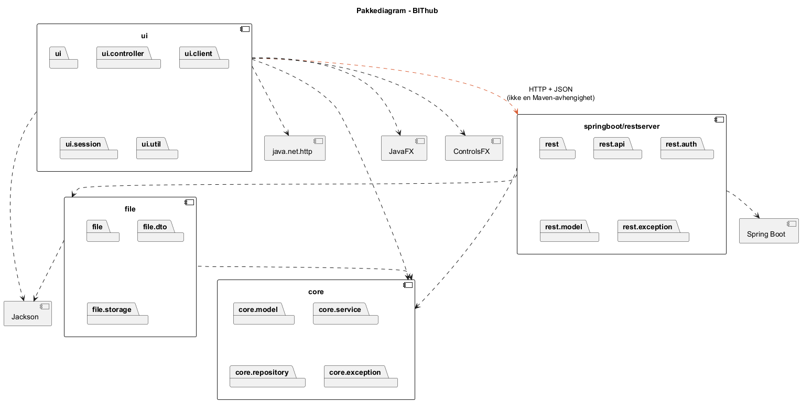

# Gr2610 - IT1901 prosjekt

[open in Eclipse Che](https://che.iaas.ntnu.no/#https://git.ntnu.no/IT1901-2026-groups/gr2610?new)

Dette er kodelageret til gruppe 2610 i faget IT1901 ved NTNU. Vi lager appen BIThub, der studenter kan anmelde emner
med terningkast 1-5 og kommentar.

I nåværende versjon kan man velge emne og sende inn en anmeldelse, eventuelt anonymt, og lese anmeldelsene for et emne. Anmeldelsene lagres automatisk i en JSON-fil.

Se [bithub/README.md](bithub/README.md) for beskrivelse av appen og dens funksjonalitet, skisser fra Figma og brukerhistorier.

## Arkitektur

Kodingsprosjektet ligger i mappen [`bithub/`](bithub/) og er bygget med tre-lags arkitektur. Hvert lag er både en egen Maven-modul og en egen Java-modul (`module-info.java`), slik at avhengighetene mellom lagene er eksplisitte.

- **core** (`bithub.core`) er domenelaget og er ikke avhengig av noen av de andre modulene.
- **file** (`bithub.file`) er persistenslaget. Det bruker domeneklassene fra `core`, implementerer `ReviewRepository` og gjør dataene om til og fra JSON med Jackson.
- **ui** (`bithub.ui`) er brukergrensesnittlaget. Det bruker `core` for domeneobjektene og `ReviewService`. `file` brukes bare i `App`, som kobler `ReviewHandler` til `ReviewService` ved oppstart.

### Pakkediagram



Kildefilen til diagrammet ligger i [`arkitektur/pakkeDiagram.puml`](arkitektur/pakkeDiagram.puml).

Pilene viser avhengighetene mellom modulene: `ui` er avhengig av `core` og `file`, `file` er
avhengig av `core` og Jackson, og `core` er ikke avhengig av noen av de andre modulene.

### Klassediagram for core


Kildefilen til diagrammet ligger i [`arkitektur/klassediagramCore.puml`](arkitektur/klassediagramCore.puml).

- Et `Course` har en liste med `Review`, og regner ut gjennomsnittlig vurdering.
- `ReviewService` validerer og sender anmeldelser videre, men kjenner bare til grensesnittet
  `ReviewRepository`. Slik er ikke `core` avhengig av hvordan dataene lagres.

### Klassediagram for file


Kildefilen til diagrammet ligger i [`arkitektur/klassediagramFile.puml`](arkitektur/klassediagramFile.puml).

- `ReviewHandler` og `UserHandler` implementerer `DataHandler` og leser og skriver JSON med Jackson.
- `ReviewHandler` implementerer også `ReviewRepository` fra `core`, og gjør om mellom
  domeneklassene (`Course`, `Review`) og objektene som lagres i filen (`CourseDTO`, `ReviewDTO`).

## Mappestruktur i kodingsprosjektet

```text
└───bithub
    ├───pom.xml
    │    -- Foreldre-POM som samler modulene core, file og ui.
    ├───README.md
    │    -- Beskrivelse av appen, skisser fra Figma og brukerhistorier.
    │
    ├───core
    │   └───src
    │       ├───main
    │       │   └───java
    │       │       └───core
    │       │           -- Course, Review og User står for domenelogikken og validering.
    │       │           -- ReviewService og ReviewRepository håndterer innsending og lagring.
    │       └───test
    │           └───java
    │               └───core
    │                   -- Testene for core-modulen ligger her.
    │
    ├───file
    │   └───src
    │       ├───main
    │       │   └───java
    │       │       └───file
    │       │           -- ReviewHandler og UserHandler leser og skriver JSON med Jackson.
    │       │           -- DataHandler er grensesnittet de to handlerne implementerer.
    │       │           -- CourseDTO, ReviewDTO og UserDTO er objektene som lagres til fil.
    │       └───test
    │           └───java
    │               └───file
    │                   -- Testene for file-modulen ligger her.
    │
    └───ui
        ├───images
        │    -- Skisser fra Figma som brukes i bithub/README.md.
        │
        └───src
            ├───main
            │   ├───java
            │   │   └───ui
            │   │       -- App, Navigation, CourseOptions og kontrollerne ligger her.
            │   └───resources
            │       └───ui
            │           -- FXML-filene og Style.css for brukergrensesnittet ligger her.
            │
            └───test
                └───java
                    └───ui
                        -- Testene for ui-modulen ligger her, skrevet med TestFX.
```

## Nødvendige verktøy og avhengigheter

- **Java 17** eller nyere
- **Maven 3.9** eller nyere
- **JavaFX 21**
- **JUnit 5**
- **JaCoCo**
- **Checkstyle** og **SpotBugs** for kodekvalitet
- **Jackson**
- **TestFX**
- **Mockito**

Alle avhengigheter bortsett fra Java og Maven lastes ned automatisk av Maven ved bygging.

## Bygge, teste og kjøre

Kommandoene kjøres fra `bithub/`-mappen:

- `mvn clean install` - bygger alle moduler
- `mvn test` - kjører testene
- `mvn verify` - kjører tester, kodekvalitetssjekker og genererer testdekningsrapport

Appen startes fra `bithub/`:
```bash
mvn clean install
mvn javafx:run

Testdekningsrapporten fra JaCoCo finnes etterpå i `bithub/core/target/site/jacoco/index.html`,
`bithub/file/target/site/jacoco/index.html` og `bithub/ui/target/site/jacoco/index.html`.