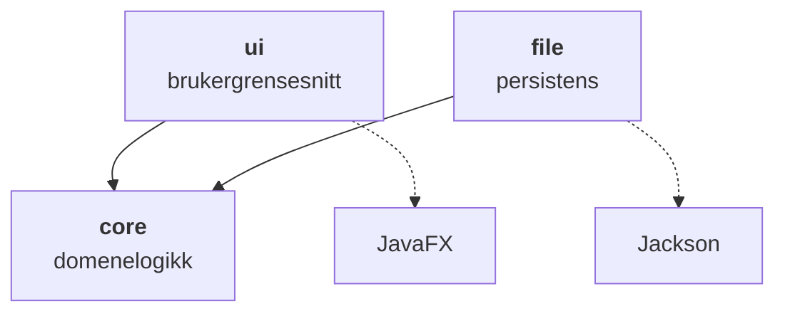

# Gr2610 - IT1901 prosjekt

[open in Eclipse Che](https://che.iaas.ntnu.no/#https://git.ntnu.no/IT1901-2026-groups/gr2610?new)

Dette er kodelageret til gruppe 2610 i faget IT1901 ved NTNU. Vi lager appen BIThub, der studenter kan anmelde emner
med terningkast 1-5 og kommentar.

I nåværende versjon kan man velge emne og sende inn en anmeldelse, eventuelt anonymt. Anmeldelsene lagres automatisk i en JSON-fil.

Se [bithub/README.md](bithub/README.md) for beskrivelse av appen og dens funksjonalitet, skisser fra Figma og brukerhistorier.

## Arkitektur

Appen er bygget med tre-lags arkitektur. Hvert lag er både en egen Maven-modul og en egen Java-modul (`module-info.java`), slik at avhengighetene mellom lagene er eksplisitte.


- **core** (`bithub.core`) er domenelaget og er ikke avhengig av noen av de andre modulene.
- **file** (`bithub.file`) er persistenslaget. Det bruker domeneklassene fra `core` og gjør dem om til og fra JSON med Jackson.
- **ui** (`bithub.ui`) er brukergrensesnittlaget. Det bruker `core` for domeneobjektene.



## Mappestruktur i kodingsprosjektet

```
└───bithub
    ├───core
    │   └───src
    │       ├───main
    │       │   └───java
    │       │       └───core
    │       │           -- Course, Review og User ligger her.
    │       │           -- De står for domenelogikken og validering i appen.
    │       └───test
    │           └───java
    │               └───core
    │                   -- Testene for core-modulen ligger her.
    │
    ├───file
    │   └───src
    │       ├───main
    │       │   └───java
    │       │       └───file
    │       │           -- ReviewHandler og UserHandler leser og skriver JSON med Jackson.
    │       │           -- CourseDTO og UserDTO er objektene som lagres til fil.
    │       └───test
    │           └───java
    │               └───file
    │                   -- Testene for file-modulen ligger her.
    │
    └───ui
        ├───images
        │    -- Skisser fra Figma som brukes i ui/README.md.
        │
        └───src
            ├───main
            │   ├───java
            │   │   └───ui
            │   │       -- App og kontrollerne AppController og EmneController ligger her.
            │   └───resources
            │       └───ui
            │           -- FXML-filene og Style.css for brukergrensesnittet ligger her.
            │                  
            └───test
                └───java
                    └───ui
                        -- Testene for ui-modulen ligger her, skrevet med TestFX.
```

## Nødvendige verktøy og avhengigheter

- **Java 17** eller nyere
- **Maven 3.9** eller nyere
- **JavaFX 21** 
- **JUnit 5**
- **JaCoCo** 
- **Checkstyle** og **SpotBugs** for kodekvalitet
- **Jackson**
- **TestFX**

Alle avhengigheter bortsett fra Java og Maven lastes ned automatisk av Maven ved bygging.


## Bygge, teste og kjøre

Kommandoene kjøres fra rota av kodelageret:

- `mvn clean install` - bygger alle moduler
- `mvn test` - kjører testene
- `mvn verify` - kjører tester, kodekvalitetssjekker og genererer testdekningsrapport

Testdekningsrapporten fra JaCoCo finnes etterpå i `core/target/site/jacoco/index.html`, `file/target/site/jacoco/index.html` og `ui/target/site/jacoco/index.html`.

Appen startes fra roten:
```
mvn clean install
mvn javafx:run
```

