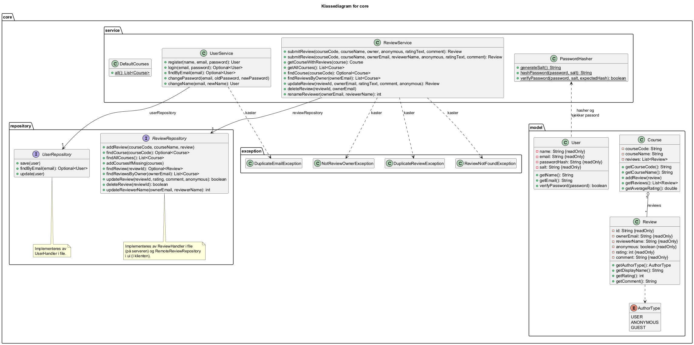

# Gr2610 - IT1901 prosjekt

[open in Eclipse Che](https://che.iaas.ntnu.no/#https://git.ntnu.no/IT1901-2026-groups/gr2610?new)

BIThub er en app der studenter kan anmelde emner med en til fem stjerner og en kommentar. Den er laget av gruppe 2610
i IT1901 ved NTNU, og består av en JavaFX-klient og en REST-server. Prosjektet er delt i fire moduler:

- `core` har domeneklassene, valideringen og tjenestene.
- `file` leser og skriver dataene som JSON-filer.
  - Filene ligger i `.bithub/` i hjemmemappen.
- `springboot/restserver` er REST-serveren.
- `ui` har brukergrensesnittet i JavaFX.

## Funksjonalitet

| Hvem | Hva de kan gjøre |
|---|---|
| Alle | Søke opp emner, lese anmeldelser med gjennomsnittlig vurdering og antall anmeldelser, og åpne infosiden |
| Gjester | Fortsette uten konto, og logge inn eller registrere seg senere |
| Innloggede brukere | Skrive en anmeldelse per emne, med navn eller anonymt, og se, endre og slette egne anmeldelser under «Mine anmeldelser» |
| Innloggede brukere | Se navn og e-post på profilsiden, endre navn og passord, og logge ut |

Se [bithub/README.md](bithub/README.md) for en beskrivelse av appen og brukerhistorier.

## Arkitektur

Kodingsprosjektet ligger i [`bithub/`](bithub/) og består av fire Maven-moduler. `core`, `file` og `ui` er i tillegg
egne Java-moduler (`module-info.java`), slik at avhengighetene mellom lagene er eksplisitte.

| Modul | Ansvar | Avhengig av |
|---|---|---|
| `core` (`bithub.core`) | Domeneklasser, validering, tjenester og grensesnitt for lagring | Ingen av de andre modulene |
| `file` (`bithub.file`) | Implementerer [`ReviewRepository`](bithub/core/src/main/java/core/repository/ReviewRepository.java) og [`UserRepository`](bithub/core/src/main/java/core/repository/UserRepository.java) med JSON-filer | `core`, Jackson |
| `ui` (`bithub.ui`) | JavaFX-klienten, som henter data fra serveren med [`RemoteReviewRepository`](bithub/ui/src/main/java/ui/client/RemoteReviewRepository.java) | `core`, JavaFX, ControlsFX, Jackson, `java.net.http` |
| `springboot/restserver` (`rest`) | REST-serveren, den eneste som leser og skriver JSON-filene | `core`, `file`, Spring Boot |

REST-API-et er beskrevet i [docs/release3/rest-api.md](docs/release3/rest-api.md).

### Pakkediagram

[](arkitektur/png/pakkeDiagram.png)

Kildefilen til diagrammet ligger i [`arkitektur/pakkeDiagram.puml`](arkitektur/pakkeDiagram.puml).

### Klassediagram for core

[](arkitektur/png/klassediagramCore.png)

Kildefilen til diagrammet ligger i [`arkitektur/klassediagramCore.puml`](arkitektur/klassediagramCore.puml).

### Klassediagram for file

[](arkitektur/png/klassediagramFile.png)

Kildefilen til diagrammet ligger i [`arkitektur/klassediagramFile.puml`](arkitektur/klassediagramFile.puml).

### Sekvensdiagrammer

Sekvensdiagrammer for brukerhistorie 1 og 2 ligger i [bithub/README.md](bithub/README.md#brukerhistorier).

## Krav

| Verktøy | Versjon | Merknad |
|---|---|---|
| JDK | 17 eller nyere | Må installeres selv |
| Maven | 3.9 eller nyere | Må installeres selv |
| WiX Toolset | 3.14 | Bare for å lage installasjonsprogrammet på Windows, må ligge i PATH |

Maven laster ned resten ved bygging:

- JavaFX 21
- ControlsFX 11.2.1
- Spring Boot 3.4.5
- Jackson 2.15.2
- JUnit 5.12.2
- TestFX 4.0.18
- Mockito 5.18.0
- JaCoCo 0.8.12
- Checkstyle 10.26.1
- SpotBugs 4.8.6.6

## Kjøre lokalt

Appen trenger at REST-serveren kjører. Start serveren i en terminal fra `bithub/`:

```bash
mvn install -DskipTests
mvn -pl springboot/restserver spring-boot:run
```

`-DskipTests` hopper over testene, men Checkstyle og SpotBugs kjører fortsatt.

Start så appen i en ny terminal, også fra `bithub/`:

```bash
mvn -pl ui javafx:run
```

Serveren kjører på `http://localhost:8080` og lagrer dataene i `courses.json` og `users.json` under `~/.bithub/`.

Vil du prøve appen med ferdige data og testbrukere, står fremgangsmåten i
[docs/release3/release3.md](docs/release3/release3.md#eksempeldata).

## Kjøre i Eclipse Che

1. Åpne lenken «open in Eclipse Che» øverst i denne filen.
2. Kjør «1. Bygg og test (mvn clean verify)».
3. Kjør «2. Start REST-serveren», og vent til serveren har startet.
4. Kjør «3. Start JavaFX-appen».
5. Åpne endepunktet `01-desktop-ui` for å se appen i nettleseren.

Kommandoene er definert i [`devfile.yaml`](devfile.yaml).

## Bygge og teste

Kommandoene kjøres fra `bithub/`:

| Kommando | Hva den gjør |
|---|---|
| `mvn test` | Kjører testene og lager testdekningsrapport |
| `mvn verify` | Gjør det samme, og kjører i tillegg Checkstyle og SpotBugs |
| `mvn clean install` | Bygger alt på nytt, kjører alle kontrollene og installerer modulene lokalt |

TestFX-testene åpner vinduer, så ikke bruk mus og tastatur mens de kjører.

Testdekningsrapporten ligger i `target/site/jacoco/index.html` i hver modul, for eksempel
`bithub/core/target/site/jacoco/index.html`.

Hva kontrollene sjekker, står i [docs/release3/code-quality.md](docs/release3/code-quality.md).

## Lage et ferdig produkt

Kommandoene kjøres fra `bithub/`. Bygg serveren som en kjørbar JAR-fil og start den:

```bash
mvn clean verify
java -jar springboot/restserver/target/rest-0.0.1-SNAPSHOT.jar
```

Pakk klienten med jlink og jpackage:

```bash
mvn -pl ui -am clean install -DskipTests
mvn -pl ui javafx:jlink
mvn -pl ui jpackage:jpackage
```

Klienten havner i `ui/target/bithub/` og startes med `bin/bithub` (`bin\bithub.bat` på Windows), og
installasjonsfilen havner i `ui/target/jpackage/`. På Windows må WiX Toolset ligge i PATH for å lage
installasjonsfilen, for eksempel `C:\Program Files (x86)\WiX Toolset v3.14\bin`.

Klienten bruker `http://localhost:8080` som serveradresse. En annen adresse settes ved pakking:

```bash
mvn -pl ui jpackage:jpackage -Dbithub.server.url=http://servernavn:8080
```

Adressen legges inn i installasjonsfilen, så den må lages på nytt for å bruke en annen adresse.

## Mappestruktur

```text
└───bithub
    ├───pom.xml
    │    -- Foreldre-POM som samler modulene core, file, ui og springboot/restserver.
    ├───README.md
    │    -- Beskrivelse av appen og brukerhistorier.
    │
    ├───core/src/main/java/core
    │   ├───model
    │   │   -- Course, Review, User og AuthorType med domenelogikk og validering.
    │   ├───service
    │   │   -- ReviewService og UserService håndterer anmeldelser og brukere.
    │   │   -- PasswordHasher hasher passord, og DefaultCourses har standardemnene.
    │   ├───repository
    │   │   -- ReviewRepository og UserRepository er grensesnittene for lagring.
    │   └───exception
    │       -- Unntak fra domeneregler, for eksempel DuplicateEmailException.
    │
    ├───file/src/main/java/file
    │   │   -- ReviewHandler og UserHandler leser og skriver JSON med Jackson.
    │   ├───dto
    │   │   -- CourseDTO, ReviewDTO og UserDTO er objektene som lagres til fil.
    │   └───storage
    │       -- DataHandler er grensesnittet for filhåndtering.
    │       -- JsonFileStorage sørger for trygg skriving når flere forespørsler kommer samtidig.
    │
    ├───springboot/restserver/src/main
    │   ├───java/rest
    │   │   │   -- RestApplication starter Spring Boot-serveren.
    │   │   ├───api
    │   │   │   -- Kontrollerne med endepunktene i REST-API-et, og felles feilhåndtering.
    │   │   ├───auth
    │   │   │   -- AuthenticationService og TokenService for innlogging og token.
    │   │   ├───exception
    │   │   │   -- Unntak som hører til en bestemt HTTP-status.
    │   │   └───model
    │   │       -- Objektene som tas imot og sendes som JSON i forespørsler og svar.
    │   └───resources
    │       -- application.properties med innstillingene til serveren.
    │
    └───ui
        ├───images
        │    -- Skisser fra Figma.
        └───src/main
            ├───java/ui
            │   │   -- App starter appen, og Navigation åpner skjermene.
            │   ├───controller
            │   │   -- En kontroller per skjerm.
            │   ├───client
            │   │   -- RemoteReviewRepository og RemoteAuthenticationClient snakker med REST-serveren.
            │   │   -- AuthenticationClient er grensesnittet kontrollerne bruker for innlogging.
            │   ├───session
            │   │   -- UserSession husker hvem som er logget inn.
            │   └───util
            │       -- BackgroundTaskRunner kjører serverkall i bakgrunnen.
            │       -- PasswordVisibility viser og skjuler passord.
            │       -- RatingStars viser vurderinger som stjerner med ControlsFX.
            └───resources/ui
                -- FXML-filene og Style.css for brukergrensesnittet.
```

Hver modul har testene sine under `src/test/java`, og de ligger stort sett i samme pakker som klassene de tester. Hva
hver pakke inneholder, og hvorfor vi delte det slik, står i [docs/release3/pakkestruktur.md](docs/release3/pakkestruktur.md).

## Dokumentasjon

Dokumentasjonen for hver innlevering ligger i egen mappe under `docs/`. Release 3 lenker til de tekniske
dokumentene og refleksjonene:

- [Release 1](docs/release1/release1.md)
- [Release 2](docs/release2/release2.md)
- [Release 3](docs/release3/release3.md)
