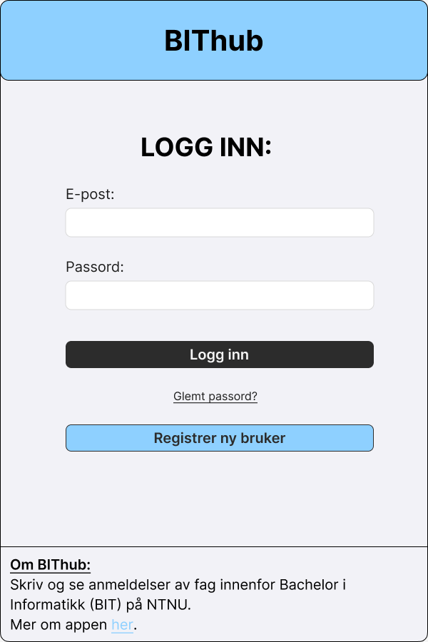
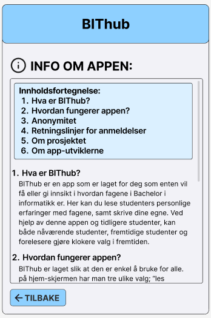
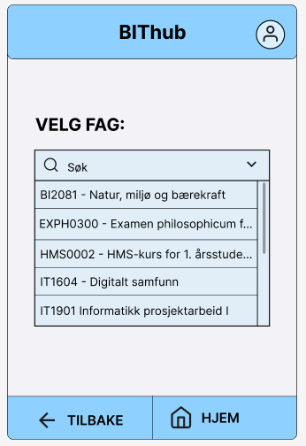
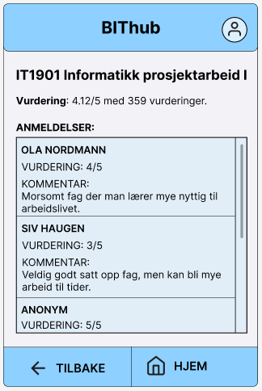

# BIThub - app for å skrive og lese anmeldelser av BIT fag

## Hva er BIThub?

Beskrivelsen under viser appens planlagte funksjonalitet når programmet er ferdigstilt.
BIThub skal gjøre det mulig for studenter ved BIT (Bachelor i informatikk) å legge igjen en offentlig anmeldelse av fag de har fullført. Hensikten med appen er at studenter skal kunne dele sine erfaringer med ulike fag ved BIT, slik at andre studenter og forelesere kan få nytte av det (se brukerhistorier).

Fra hjemskjermen kan man velge mellom å lese anmeldelser, skrive en anmeldelse og se egne anmeldelser.

**Lese anmeldelser:** Man kan bla gjennom fagene som tilbys på BIT, sortert etter fagkode, eller søke dem opp. Trykker man på et fag, får man se anmeldelsene av faget, gjennomsnittlig vurdering fra 1 til 5 og antall anmeldelser.

**Skrive anmeldelse:** Man velger fag på samme måte som når man leser. Deretter fyller man ut et skjema der man vurderer faget fra 1 til 5, skriver en kommentar og velger om anmeldelsen skal være anonym.

**Mine anmeldelser:** Her kan man endre og slette anmeldelsene man har skrevet selv.

**Profil:** Her kan man endre navn, brukernavn og passord, og logge ut.
Informasjon om appen finnes via lenken nederst på innloggings- og hjemskjermen.

## Funksjonalitet

### Implementert i release 2

- **Velge fag:** Man kan velge fag fra en liste, som brukes når man skal lese og skrive anmeldelser.
- **Lese anmeldelser:** Se anmeldelser til fag, i tillegg til gjennomsnittlig vurdering og antall anmeldelser til et fag.
- **Skrive anmeldelser:** Velge et fag og skrive en anmeldelse med vurdering fra 1 til 5, kommentar og anonymitet.
- **Lagre anmeldelser:** Anmeldelser valideres og lagres automatisk i en JSON-fil.

### Implementert til release 3

- **Søk etter fag:** Filtrer emnelisten på emnekode eller emnenavn mens
  du skriver. Søket ignorerer store og små bokstaver og mellomrom før
  og etter søket. Trefflisten åpnes automatisk og viser opptil seks
  emner om gangen, med rulling ved flere treff. Tomt søk viser alle
  emner. Søkefeltet brukes både når man skal lese og skrive anmeldelser.

### Planlagt til release 3

- **Innlogging og registrering:** Koble brukere til appen og lage sidene for dem.
- **Profil:** Lage en profilside hvor det er mulig å endre navn og passord.
- **Mine anmeldelser:** Implementere slik at dine tidligere skrevne anmeldelser dukker opp her.

## Bygging, installasjon og oppstart

BIThub består av en JavaFX-klient og en separat Spring Boot-server.
Serveren må kjøre for at klienten skal kunne hente og lagre data.

Klienten kan pakkes med jlink og jpackage på Windows, macOS og Linux.
Pakkingen bruker `jpackage-maven-plugin` i `ui/pom.xml` og må kjøres
på operativsystemet installasjonspakken skal brukes på.

### Forutsetninger

- JDK 17 eller nyere og Maven tilgjengelig i PATH.
- Windows: WiX Toolset 3.14 for å lage `.exe`-installasjonsfil.
- macOS: Et macOS-miljø for å lage `.dmg`-installasjonsfil.
- Linux: Nødvendige pakkeverktøy, blant annet `fakeroot` for Debian-
  baserte systemer eller `rpmbuild` for RPM-baserte systemer.
- Den pakkede JavaFX-klienten trenger ikke en separat Java-installasjon.
- REST-serveren krever Java 17 eller nyere.

Alle byggekommandoene nedenfor kjøres fra `bithub/`.

### Bygg og start REST-serveren

Bygg hele prosjektet og kjør tester og kvalitetskontroller:

```bash
mvn clean verify
```

Dette oppretter en kjørbar server-JAR:

`springboot/restserver/target/rest-0.0.1-SNAPSHOT.jar`

Start serveren i et eget terminalvindu.

Windows CMD:

```cmd
java -jar "springboot\restserver\target\rest-0.0.1-SNAPSHOT.jar"
```

macOS og Linux:

```bash
java -jar springboot/restserver/target/rest-0.0.1-SNAPSHOT.jar
```

Serveren lytter som standard på `http://localhost:8080` og kjører
til den stoppes med `Ctrl+C`.

Emner, anmeldelser og brukere lagres som standard i `.bithub/` under
brukerens hjemmemappe, i filene `courses.json` og `users.json`.

Filstiene kan overstyres med Spring Boot-argumentene
`--bithub.reviews-file` og `--bithub.users-file`.

### Pakk JavaFX-klienten med Maven

Den samme byggeprosessen brukes på Windows, macOS og Linux:

```bash
mvn -pl ui -am clean install -DskipTests
mvn -pl ui javafx:jlink
mvn -pl ui jpackage:jpackage
```

Første kommando bygger klienten og avhengighetene. Andre kommando
lager en tilpasset Java-runtime med jlink. Tredje kommando oppretter
en installasjonspakke for operativsystemet som brukes.

`-DskipTests` gjelder bare pakkebyggingen. Kjør `mvn clean verify`
separat for å verifisere hele prosjektet med tester og kvalitetskontroller.

Resultatene finnes under `ui/target/`:

- `bithub/`: Klienten med en tilpasset Java-runtime fra jlink. Start den med
  `ui\target\bithub\bin\bithub.bat` på Windows eller `ui/target/bithub/bin/bithub`
  på macOS og Linux. Serveren må kjøre.
- `bithub.zip`: Samme mappe som zip-fil, som kan deles og pakkes ut på en annen
  maskin med samme operativsystem. Krever ikke WiX eller en egen Java-installasjon.
- `jpackage/`: Native installasjonspakke fra jpackage.

Installasjonsformatene avhenger av operativsystemet:

| Operativsystem | Installasjonsformat |
| --- | --- |
| Windows | `.exe` |
| macOS | `.dmg` |
| Linux | `.deb` eller `.rpm`, avhengig av miljø og pakkeverktøy |

På macOS og Linux må JavaFX-klienten bygges med riktig JDK og
plattformavhengige biblioteker for maskinen som skal kjøre den.

REST-serveren følger ikke med klientens installasjonspakke og
må startes separat.

### Windows: bygg også app-image

På Windows kan hele pakkingen kjøres med skriptet:

```cmd
call scripts\package-windows.cmd
```

Skriptet bygger JavaFX-klienten, lager en tilpasset Java-runtime,
oppretter et app-image og bruker Maven-pluginen til å lage
Windows-installasjonsfilen.

Resultatene finnes under `ui/target/jpackage/`:

- `BIThub-1.0.0.exe`: Windows-installasjonsprogram.
- `BIThub/BIThub.exe`: Kjørbar klient i app-image-format.

Den installerte klienten kan startes uten Maven eller separat
Java-installasjon.

### Konfigurer serveradressen

Den pakkede klienten bruker `http://localhost:8080` som standard.

Ved pakking direkte med Maven kan serveradressen endres med
egenskapen `bithub.server.url`:

```bash
mvn -pl ui jpackage:jpackage -Dbithub.server.url=http://servernavn:8080
```

På Windows kan serveradressen også konfigureres gjennom
miljøvariabelen `BITHUB_SERVER_URL` før pakkeskriptet kjøres:

```cmd
set "BITHUB_SERVER_URL=http://servernavn:8080"
call scripts\package-windows.cmd
```

Begge metodene legger serveradressen inn som JVM-argumentet
`-Dbithub.server-url=...` i den pakkede klienten.

Adressen bestemmes under pakking. For å distribuere klienten
med en annen standardadresse pakkes den på nytt.

### Verifisering

Windows-pakkingen er manuelt verifisert på Windows 10 med
WiX Toolset 3.14.1.

Følgende er verifisert:

- Maven-bygging og opprettelse av tilpasset Java-runtime med jlink.
- Generering av Windows-installasjonsfil med jpackage via Maven.
- Generering av Windows app-image med pakkeskriptet.
- Oppstart av Spring Boot fra kjørbar JAR.
- HTTP 200 og JSON-respons fra REST-endepunktet `/api/courses`.
- Korrekt serveradresse i den installerte klientens `BIThub.cfg`.

Den tidligere Windows-løsningen er også prøvekjørt med installert
JavaFX-klient mot kjørende REST-server.

macOS- og Linux-pakkingen er konfigurert gjennom Maven, men er
foreløpig ikke manuelt verifisert på disse operativsystemene.

## Brukerlagring på REST-serveren

Serveren kobler [`UserService`](core/src/main/java/core/service/UserService.java) i `core` til [`UserHandler`](file/src/main/java/file/UserHandler.java) i `file` gjennom
grensesnittet [`UserRepository`](core/src/main/java/core/repository/UserRepository.java). Koblingen konfigureres med Spring-beans i
[`RestApplication`](springboot/restserver/src/main/java/rest/RestApplication.java).

Brukere lagres som JSON med navn, e-post, passordhash og salt. Standardfilen
er `.bithub/users.json` i hjemmemappen til brukeren som kjører serveren.
Filstien kan overstyres med Spring-innstillingen `bithub.users-file`.

Serverkoblingen er på plass. REST-endepunkter for registrering og
innlogging implementeres i #174.

## Illustrerende skjermbilde - Figma

Vi lagde illustrerende skjermbilder i Figma for å beskrive hvordan appen skal se ut og fungere når den er ferdig

### Innlogging og registrering

<table>
  <tr>
    <td align="center">
      <b>Logg inn</b><br>
      
    </td>
    <td align="center">
      <b>Registrer ny bruker</b><br>
      
    </td>
  </tr>
</table>

### Info og profil

<table>
  <tr>
    <td align="center">
      <b>Info om appen</b><br>
      
    </td>
    <td align="center">
      <b>Profil side</b><br>
      
    </td>
    <td align="center">
      <b>Endre passord</b><br>
      
    </td>
  </tr>
</table>

### Hjem og fagvalg

<table>
  <tr>
    <td align="center">
      <b>Hjemmeside</b><br>
      
    </td>
    <td align="center">
      <b>Velg fag</b><br>
      <br>
    </td>
  </tr>
</table>

### Anmeldelser

<table>
  <tr>
    <td align="center">
      <b>Lese anmeldelser - eksempel</b><br>
      
    </td>
    <td align="center">
      <b>Skrive anmeldelse</b><br>
      
    </td>
  </tr>
  <tr>
    <td align="center">
      <b>Mine anmeldelser - eksempel</b><br>
      
    </td>
    <td align="center">
      <b>Endre egen anmeldelse - eksempel</b><br>
      
    </td>
  </tr>
</table>

# Brukerhistorier

## Brukerhistorie 1

**Brukerhistorie 1:** «Som student, skal jeg kunne skrive anmeldelser av fag, for å kunne
hjelpe andre studenter med for eksempel å velge riktig valgfag for dem.»

Diagrammet dekker flyten fra brukeren velger fag i [`CourseSelectionController`](ui/src/main/java/ui/controller/CourseSelectionController.java), til anmeldelsen er
validert i `core` og lagret som JSON av `file`-modulen.

### Sekvensdiagram for brukerhistorie 1:


Kildefilen til diagrammet (PlantUML) ligger i
[`arkitektur/brukerhistorie1Sekvensdiagram.puml`](../arkitektur/brukerhistorie1Sekvensdiagram.puml).

PNG-en er generert fra `.puml`-filen via [plantuml.com](https://www.plantuml.com/plantuml/uml/):
lim inn innholdet i `.puml`-filen der og last ned bildet som PNG.

### Kommentarer til diagrammet

- **`ui → core`:** [`WriteReviewController`](ui/src/main/java/ui/controller/WriteReviewController.java) kjenner kun [`core.service.ReviewService`](core/src/main/java/core/service/ReviewService.java). Den vet ingenting om
  at anmeldelsen til slutt havner i en JSON-fil.
- **`core → file` (via grensesnitt):** [`ReviewService`](core/src/main/java/core/service/ReviewService.java) kjenner kun [`core.repository.ReviewRepository`](core/src/main/java/core/repository/ReviewRepository.java).
  [`ReviewHandler`](file/src/main/java/file/ReviewHandler.java) i `file`-modulen implementerer dette grensesnittet, så `core` er ikke
  avhengig av `file`.
- **Kobling ved oppstart:** [`App.start(...)`](ui/src/main/java/ui/App.java#L30)
  setter opp [`RemoteReviewRepository`](ui/src/main/java/ui/client/RemoteReviewRepository.java)
  og [`ReviewService`](core/src/main/java/core/service/ReviewService.java),
  og gir tjenesten videre til [`Navigation`](ui/src/main/java/ui/Navigation.java).
  Klienten kommuniserer med REST-serveren og er ikke avhengig av `file`.
- **Validering ligger i `core`:** Både format på vurdering (1–5, gyldig tall) og selve
  [`Review`](core/src/main/java/core/model/Review.java)-objektet valideres i `core` ([`ReviewService.parseRating`](core/src/main/java/core/service/ReviewService.java#L265) og [`Review`](core/src/main/java/core/model/Review.java)-konstruktøren),
  ikke i kontrolleren. Kontrolleren viser bare feilmeldingen den får tilbake.

## Brukerhistorie 2

**Brukerhistorie 2:** «Som foreleser, skal jeg kunne lese anmeldelser av faget jeg har, for å kunne forbedre og tilpasse faget til neste år.»

Diagrammet dekker flyten fra foreleseren trykker «Les anmeldelser» på hjemmesiden, til
anmeldelsene er hentet fra JSON-filen i `file`, gjort om til domeneobjekter og vist med
gjennomsnitt og antall i [`ReadReviewsController`](ui/src/main/java/ui/controller/ReadReviewsController.java).

### Sekvensdiagram for brukerhistorie 2:


Kildefilen til diagrammet (PlantUML) ligger i
[`arkitektur/brukerhistorie2Sekvensdiagram.puml`](../arkitektur/brukerhistorie2Sekvensdiagram.puml).

PNG-en er generert fra `.puml`-filen via [plantuml.com](https://www.plantuml.com/plantuml/uml/):
lim inn innholdet i `.puml`-filen der og last ned bildet som PNG.

### Kommentarer til diagrammet

- **Samme fagvelger for lesing og skriving:** [`Navigation.showCourseSelectionForReading`](ui/src/main/java/ui/Navigation.java#L168)
  åpner den samme [`CourseSelection`](ui/src/main/resources/ui/CourseSelection.fxml)-siden som brukes når man skriver en anmeldelse, men gir
  [`CourseSelectionController`](ui/src/main/java/ui/controller/CourseSelectionController.java) beskjed om å kalle [`Navigation::showReviews`](ui/src/main/java/ui/Navigation.java#L179) når et fag er valgt.
  Kontrolleren vet ikke selv hvilken side som åpnes.
- **`ui → core`:** [`ReadReviewsController`](ui/src/main/java/ui/controller/ReadReviewsController.java) kjenner kun [`core.service.ReviewService`](core/src/main/java/core/service/ReviewService.java). Den ber om
  emnet med [`getCourseWithReviews`](core/src/main/java/core/service/ReviewService.java#L105) og vet ikke at anmeldelsene kommer fra en JSON-fil.
- **`core → file` (via grensesnitt):** [`ReviewService`](core/src/main/java/core/service/ReviewService.java) kaller [`findCourse`](core/src/main/java/core/repository/ReviewRepository.java#L32) på
  [`core.repository.ReviewRepository`](core/src/main/java/core/repository/ReviewRepository.java). [`ReviewHandler`](file/src/main/java/file/ReviewHandler.java) i `file` implementerer metoden, leser filen og
  gjør [`CourseDTO`](file/src/main/java/file/dto/CourseDTO.java) om til [`Course`](core/src/main/java/core/model/Course.java). DTO-en brukes bare inne i `file`.
- **Fag uten anmeldelser:** Finnes ikke faget i filen, returnerer [`findCourse`](core/src/main/java/core/repository/ReviewRepository.java#L32) en tom
  `Optional`, og [`ReviewService`](core/src/main/java/core/service/ReviewService.java) lager et tomt [`Course`](core/src/main/java/core/model/Course.java). Kontrolleren trenger derfor ikke å
  håndtere at faget mangler.
- **Gjennomsnittet regnes ut i `core`:** [`Course.getAverageRating()`](core/src/main/java/core/model/Course.java#L82) står for utregningen.
  Kontrolleren formaterer bare tallet med to desimaler.

## Brukerhistorie 3

**Brukerhistorie 3:** «Som mulig fremtidig informatikkstudent, skal jeg kunne lese anmeldelsene av fagene, for å kunne se om dette er noe jeg har lyst å studere.»

Brukerhistorie 3 bruker samme flyt som brukerhistorie 2: man velger et fag under «Les anmeldelser»
og ser anmeldelsene, gjennomsnittet og antallet. Se
[sekvensdiagrammet for brukerhistorie 2](#sekvensdiagram-for-brukerhistorie-2).

## Brukerhistorie 4

**Brukerhistorie 4:** «Som student, skal jeg kunne opprette en bruker og logge inn, for å kunne skrive, endre og slette egne anmeldelser uten at andre kan endre på dem.»

Diagrammet kommer i en senere sprint.

## Brukerhistorie 5

**Brukerhistorie 5:** «Som student, skal jeg kunne se, endre og slette egne anmeldelser, for å holde anmeldelsene mine oppdaterte og relevante for andre studenter.»

Diagrammet kommer i en senere sprint.

## Brukerhistorie 6

**Brukerhistorie 6:** «Som registrert bruker, skal jeg kunne se profilen min og endre passordet mitt, for å kunne bytte til et sikrere passord hvis jeg tror noen andre kjenner det.»

Diagrammet kommer i en senere sprint.

## Brukerhistorie 7

**Brukerhistorie 7:** «Som student, skal jeg kunne søke etter fag med fagkode eller navn, for å raskt finne faget jeg vil lese eller skrive anmeldelser om.»

Diagrammet kommer i en senere sprint.