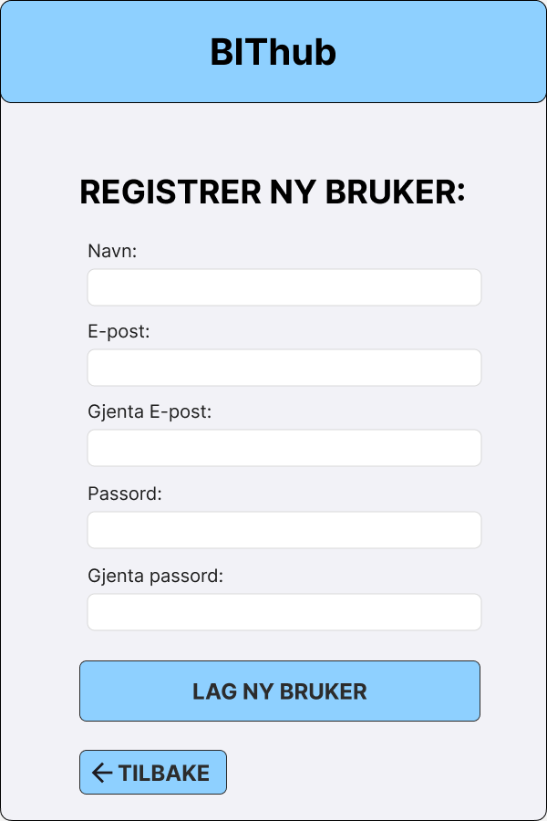
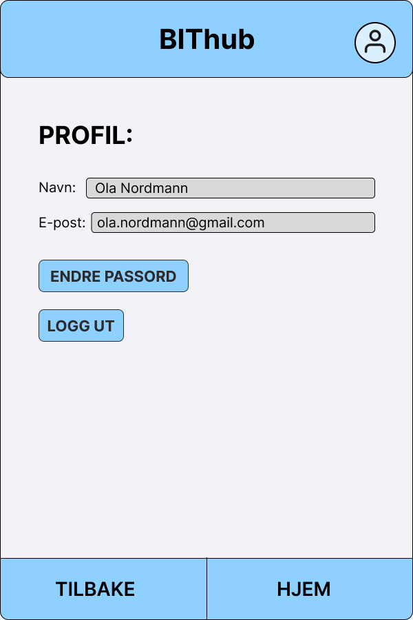
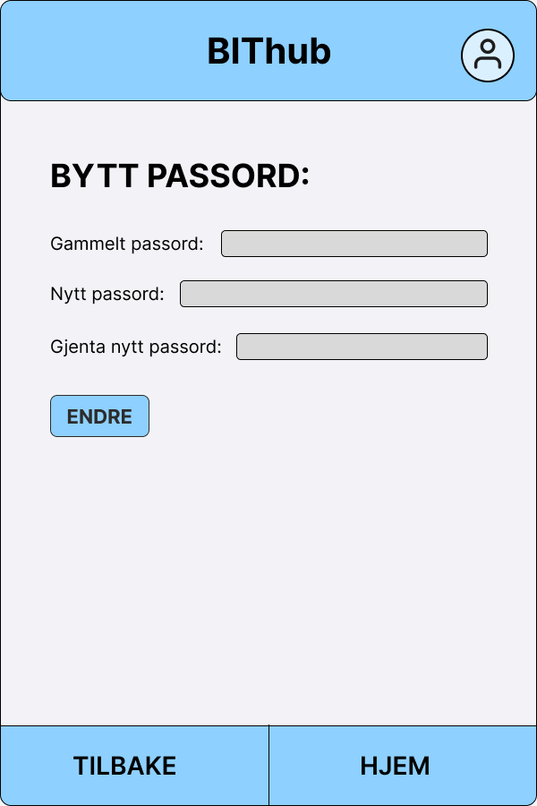
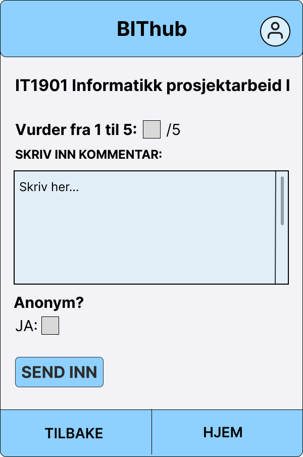
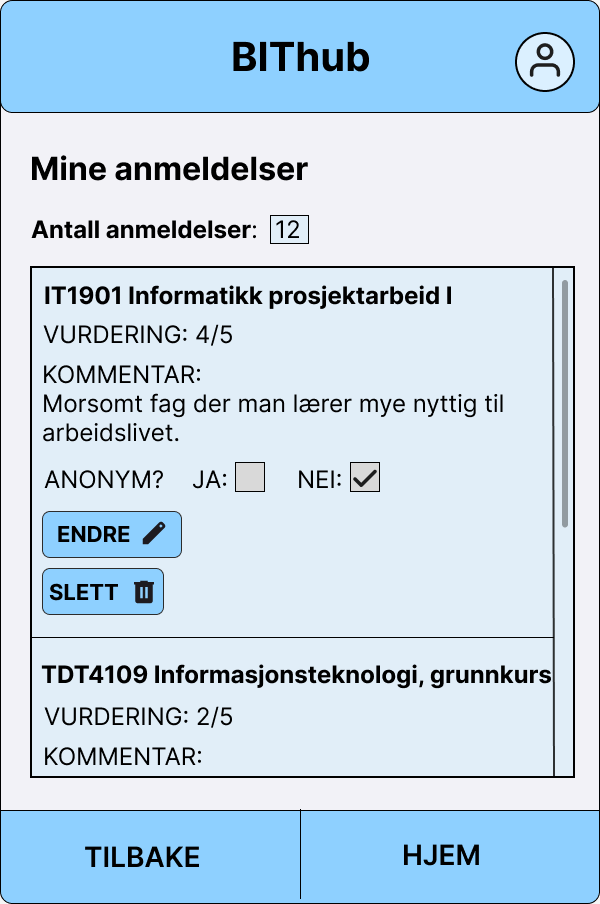
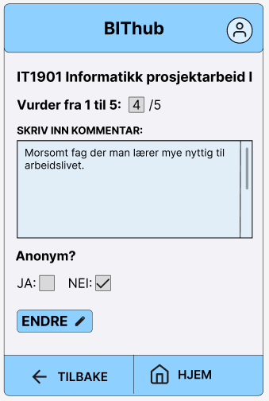
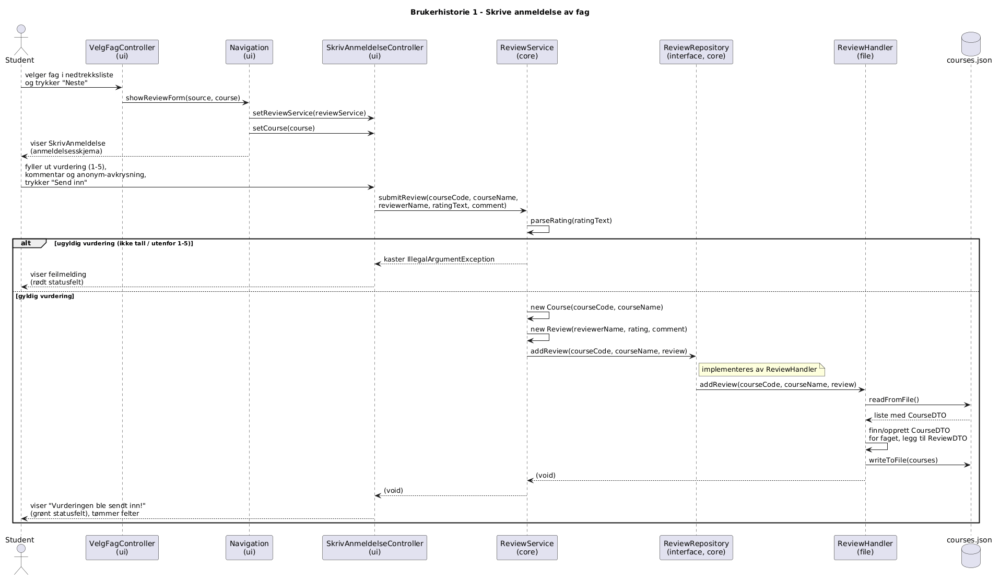

# BIThub - app for å skrive og lese anmeldelser av BIT fag

## Hva er BIThub?
BIThub skal gjøre det mulig for studenter ved BIT (Bachelor i informatikk) å legge igjen en offentlig anmeldelse av fag de har fullført. Hensikten med appen er at studenter skal kunne dele sine erfaringer med ulike fag ved BIT, slik at andre studenter og forelesere kan få nytte av det (se brukerhistorier).

Fra hjemskjermen kan man velge mellom å lese anmeldelser, skrive en anmeldelse og se egne anmeldelser.

**Lese anmeldelser:** Man kan bla gjennom fagene som tilbys på BIT, sortert etter fagkode, eller søke dem opp. Trykker man på et fag, får man se anmeldelsene av faget, gjennomsnittlig vurdering fra 1 til 5 og antall anmeldelser.

**Skrive anmeldelse:** Man velger fag på samme måte som når man leser. Deretter fyller man ut et skjema der man vurderer faget fra 1 til 5, skriver en kommentar og velger om anmeldelsen skal være anonym.

**Mine anmeldelser:** Her kan man endre og slette anmeldelsene man har skrevet selv.

**Profil:** Her kan man endre navn, brukernavn og passord, og logge ut.
Informasjon om appen finnes via lenken nederst på innloggings- og hjemskjermen.

## Funksjonalitet

### Implementert i release 2

- **Velge fag:** Man kan velge fag fra en liste, som brukes når man skal lese og skrive anmeldelser.
- **Lese anmeldelser:** Se anmeldelser til fag, i tillegg til gjennomsnittlig vurdering og antall anmeldelser til et fag.
- **Skrive anmeldelser:** Velge et fag og skrive en anmeldelse med vurdering fra 1 til 5, kommentar og anonymitet.
- **Lagre anmeldelser:** Anmeldelser valideres og lagres automatisk i en JSON-fil.

### Planlagt til release 3

- **Innlogging og registrering:** Koble brukere til appen og lage sidene for dem.
- **Profil:** Lage en profilside hvor det er mulig å endre navn og passord.
- **Mine anmeldelser:** Implementere slik at dine tidligere skrevne anmeldelser dukker opp her.

## Illustrerende skjermbilde - Figma

Vi lagde illustrerende skjermbilder i Figma for å beskrive hvordan appen skal se ut og fungere når den er ferdig

### Innlogging og registrering

<table>
  <tr>
    <td align="center">
      <b>Logg inn</b> 
      
    </td>
    <td align="center">
      <b>Registrer ny bruker</b> 
      
    </td>
  </tr>
</table>

### Info og profil

<table>
  <tr>
    <td align="center">
      <b>Info om appen</b> 
      
    </td>
    <td align="center">
      <b>Profil side</b> 
      
    </td>
    <td align="center">
      <b>Endre passord</b> 
      
    </td>
  </tr>
</table>

### Hjem og fagvalg

<table>
  <tr>
    <td align="center">
      <b>Hjem skjerm</b> 
      
    </td>
    <td align="center">
      <b>Velg fag</b> 
       
    </td>
  </tr>
</table>

### Anmeldelser

<table>
  <tr>
    <td align="center">
      <b>Lese anmeldelser - eksempel</b> 
      
    </td>
    <td align="center">
      <b>Skrive anmeldelse - eksempel</b> 
      
    </td>
  </tr>
  <tr>
    <td align="center">
      <b>Mine anmeldelser - eksempel</b> 
      
    </td>
    <td align="center">
      <b>Endre egen anmeldelse - eksempel</b> 
      
    </td>
  </tr>
</table>

# Brukerhistorier

## Brukerhistorie 1

**Brukerhistorie 1:** «Som student, skal jeg kunne skrive anmeldelser av fag, for å kunne
hjelpe andre studenter med for eksempel å velge riktig valgfag for dem.»

Diagrammet dekker flyten fra brukeren velger fag i `VelgFagController`, til anmeldelsen er
validert i `core` og lagret som JSON av `file`-modulen.

### Sekvensdiagram for brukerhistorie 1:

Kildefilen til diagrammet (PlantUML) ligger i
[`arkitektur/brukerhistorie1Sekvensdiagram.puml`](../arkitektur/brukerhistorie1Sekvensdiagram.puml).

PNG-en er generert fra `.puml`-filen via [plantuml.com](https://www.plantuml.com/plantuml/uml/):
lim inn innholdet i `.puml`-filen der og last ned bildet som PNG.

### Kommentarer til diagrammet

- **`ui → core`:** `SkrivAnmeldelseController` kjenner kun `core.ReviewService`. Den vet ingenting om
  at anmeldelsen til slutt havner i en JSON-fil.
- **`core → file` (via grensesnitt):** `ReviewService` kjenner kun `core.ReviewRepository`.
  `ReviewHandler` i `file`-modulen implementerer dette grensesnittet, så `core` er ikke
  avhengig av `file`.
- **Kobling ved oppstart:** Det er `App.start(...)` som oppretter
  `new ReviewService(new ReviewHandler())` og gir tjenesten videre til `Navigation`. Dette
  er eneste sted i `ui` som kjenner den konkrete `file`-klassen.
- **Validering ligger i `core`:** Både format på vurdering (1–5, gyldig tall) og selve
  `Review`-objektet valideres i `core` (`ReviewService.parseRating` og `Review`-konstruktøren),
  ikke i kontrolleren. Kontrolleren viser bare feilmeldingen den får tilbake.

## Brukerhistorie 2

**Brukerhistorie 2:** «Som foreleser, skal jeg kunne lese anmeldelser av faget jeg har, for å kunne forbedre og tilpasse faget til neste år.»

Diagrammet dekker flyten fra foreleseren trykker «Les anmeldelser» på hjemmesiden, til
anmeldelsene er hentet fra JSON-filen i `file`, gjort om til domeneobjekter og vist med
gjennomsnitt og antall i `LeseAnmeldelserController`.

### Sekvensdiagram for brukerhistorie 2:

Kildefilen til diagrammet (PlantUML) ligger i
[`arkitektur/brukerhistorie2Sekvensdiagram.puml`](../arkitektur/brukerhistorie2Sekvensdiagram.puml).

PNG-en er generert fra `.puml`-filen via [plantuml.com](https://www.plantuml.com/plantuml/uml/):
lim inn innholdet i `.puml`-filen der og last ned bildet som PNG.

### Kommentarer til diagrammet

- **Samme fagvelger for lesing og skriving:** `Navigation.showCourseSelectionForReading`
  åpner den samme `VelgFag`-siden som brukes når man skriver en anmeldelse, men gir
  `VelgFagController` beskjed om å kalle `Navigation::showReviews` når et fag er valgt.
  Kontrolleren vet ikke selv hvilken side som åpnes.
- **`ui → core`:** `LeseAnmeldelserController` kjenner kun `core.ReviewService`. Den ber om
  emnet med `getCourseWithReviews` og vet ikke at anmeldelsene kommer fra en JSON-fil.
- **`core → file` (via grensesnitt):** `ReviewService` kaller `findCourse` på
  `core.ReviewRepository`. `ReviewHandler` i `file` implementerer metoden, leser filen og
  gjør `CourseDTO` om til `Course`. DTO-en brukes bare inne i `file`.
- **Fag uten anmeldelser:** Finnes ikke faget i filen, returnerer `findCourse` en tom
  `Optional`, og `ReviewService` lager et tomt `Course`. Kontrolleren trenger derfor ikke å
  håndtere at faget mangler.
- **Gjennomsnittet regnes ut i `core`:** `Course.getAverageRating()` står for utregningen.
  Kontrolleren formaterer bare tallet med to desimaler.

## Brukerhistorie 3

**Brukerhistorie 3:** «Som mulig fremtidig informatikkstudent, skal jeg kunne lese anmeldelsene av fagene, for å kunne se om dette er noe jeg har lyst å studere.»

Brukerhistorie 3 bruker samme flyt som brukerhistorie 2: man velger et fag under «Les anmeldelser»
og ser anmeldelsene, gjennomsnittet og antallet. Se
[sekvensdiagrammet for brukerhistorie 2](#sekvensdiagram-for-brukerhistorie-2).
