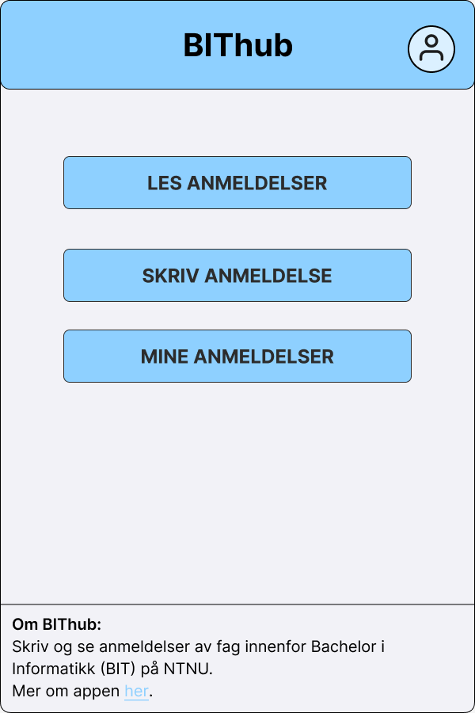

# BIThub - app for å skrive og lese anmeldelser av BIT fag

## Beskrivelse av appen og dens funksjonalitet

BIThub skal gjøre det mulig for studenter ved BIT (Bachelor i informatikk) å legge igjen en offentlig anmeldelse av fag de har fullført. Hensikten med appen er at studenter skal kunne dele sine erfaringer med ulike fag ved BIT, slik at andre studenter og forelsere kan få nytte av det (se brukerhistorier).

Appen er i utgangspunktet lagt opp slik at man kan velge mellom å lese anmeldelser, skrive en anmeldelse og se egne anmeldelser. 
Velger man å lese anmeldelser, kan man enten bla gjennom de forskjellige fagene som blir tilbudt av BIT, sortert etter fagkode, eller så kan man søke dem opp manuelt. Trykker man på et fag, får man oversikt over de ulike anmeldelsene for dette faget, samt en gjennomsnittlig vurdering fra 1-5 basert på tidligere anmeldelser, og antall anmeldelser for faget. 
Dersom man ønsker å skrive egen anmeldelse trykker man på "Skriv anmeldelse" på hjem skjermen. For å velge fag, er samme oppsett som for å lese fag. Etter å ha valgt fag, vil man få et skjema der man kan vurdere faget fra 1- 5, deretter skrive en kommentar og til slutt velge om anmeldelsen skal være anonym.
Om man ønsker å endre eller slette en anmeldelse i ettertid, har man funksjonen "Mine anmeldelser", som gjør det mulig å endre og slette alle anmeldelsene man har skrevet selv. 
Inne på profil finnes også funksjoner for å endre navn, brukernavn og passord, samt logge ut. 
Det er mulig å se informasjon om appen om man klikker på linken som ligger nederst på "logg inn" skjermen og "hjem" skjermen.

## Illustrerende skjermbilde - Figma

Vi lagde illustrerende skjermbilder i Figma for å beskrive hvordan appen skal se ut og fungere når den er ferdig. 
### Innlogging og registrering

<table>
<tr>
<td align="center">
<b>Logg inn</b> 

</td>
<td align="center">
<b>Registrer ny bruker</b> 

</td>
</tr>
</table>

### Info og profil

<table>
<tr>
<td align="center">
<b>Info om appen</b> 

</td>
<td align="center">
<b>Profil side</b> 

</td>
<td align="center">
<b>Endre passord</b> 

</td>
</tr>
</table>

### Hjem og fagvalg

<table>
<tr>
<td align="center">
<b>Hjem skjerm</b> 

</td>
<td align="center">
<b>Velg fag</b> 
 
<!-- Denne siden vil bli brukt for å velge fag både når man skal skrive anmeldelser og lese anmeldelser. -->
</td>
</tr>
</table>

### Anmeldelser

<table>
<tr>
<td align="center">
<b>Lese anmeldelser - eksempel</b> 

</td>
<td align="center">
<b>Skrive anmeldelse - eksempel</b> 

</td>
</tr>
<tr>
<td align="center">
<b>Mine anmeldelser - eksempel</b> 

</td>
<td align="center">
<b>Endre egen anmeldelse - eksempel</b> 

</td>
</tr>
</table>

## Brukerhistorier

1: Som student, skal jeg kunne skrive anmeldelser av fag, for å kunne hjelpe andre studenter med for eksempel å velge riktig valgfag for dem.

2: Som foreleser, skal jeg kunne lese anmeldelser av faget jeg har, for å kunne forbedre og tilpasse faget til neste år.

3: Som mulig fremtidig informatikkstudent, skal jeg kunne lese anmeldelsene av fagene, for å kunne se om dette er noe jeg har lyst å studere.