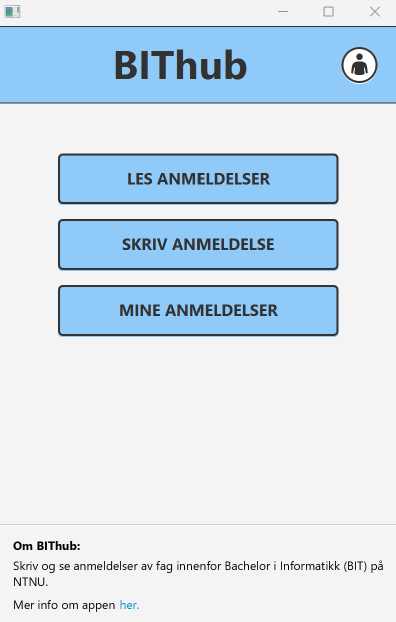
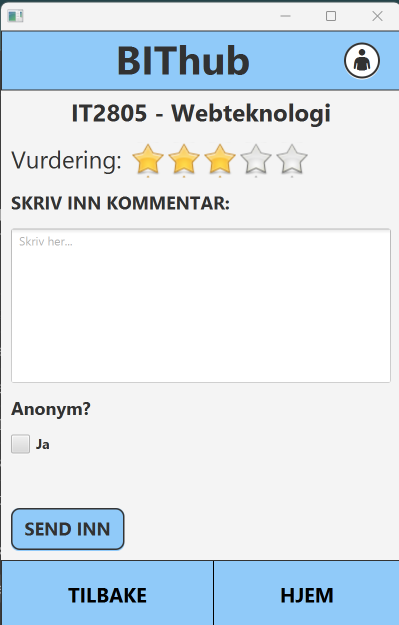
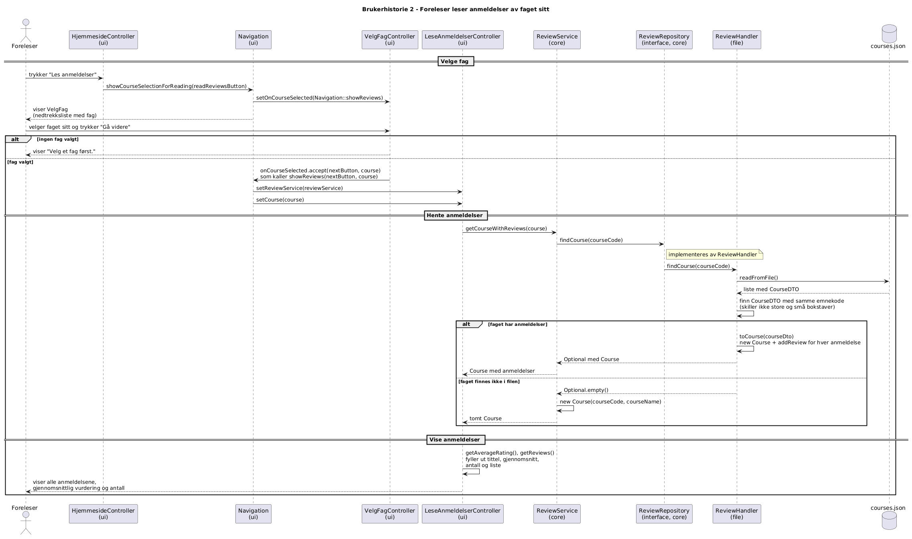
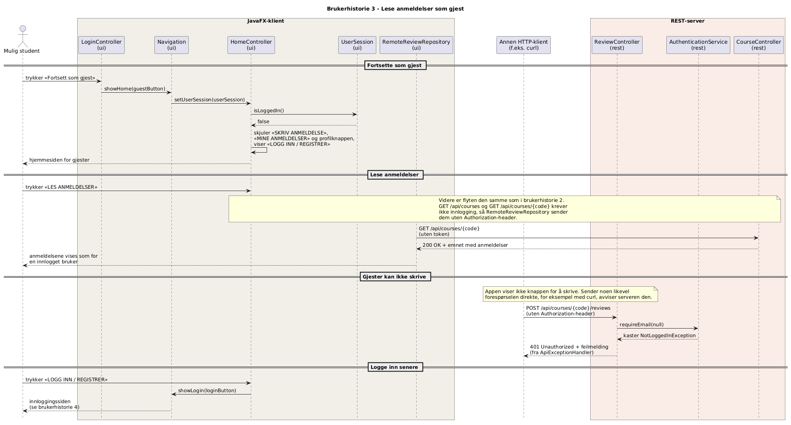
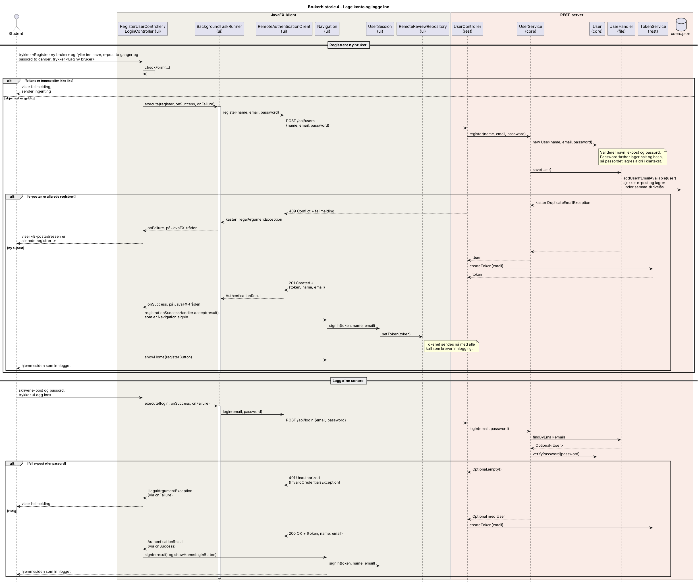
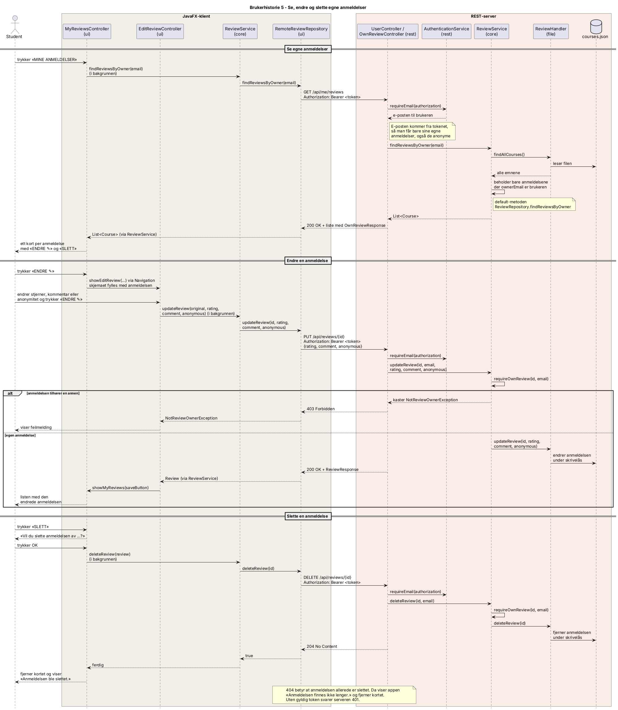
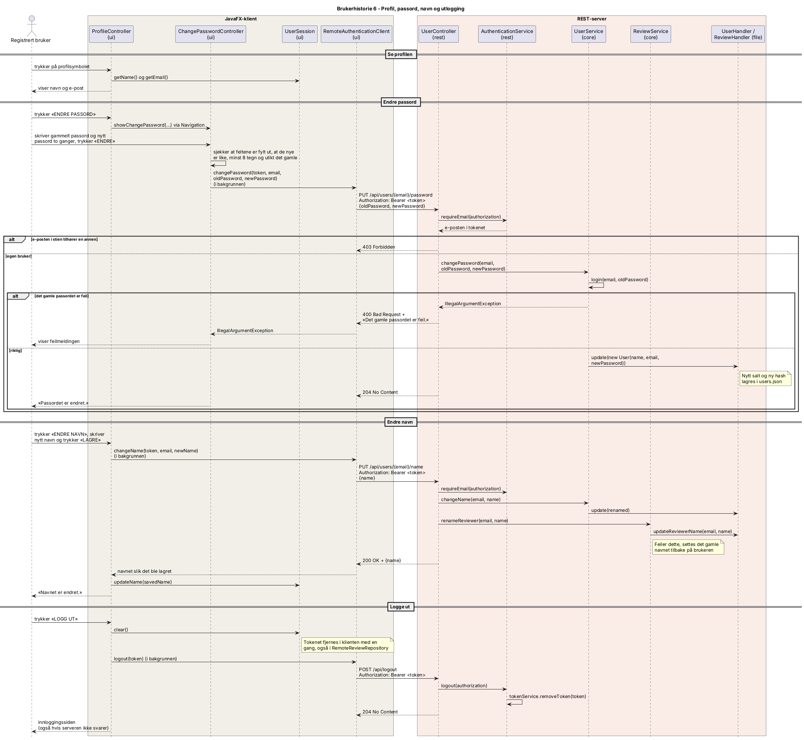
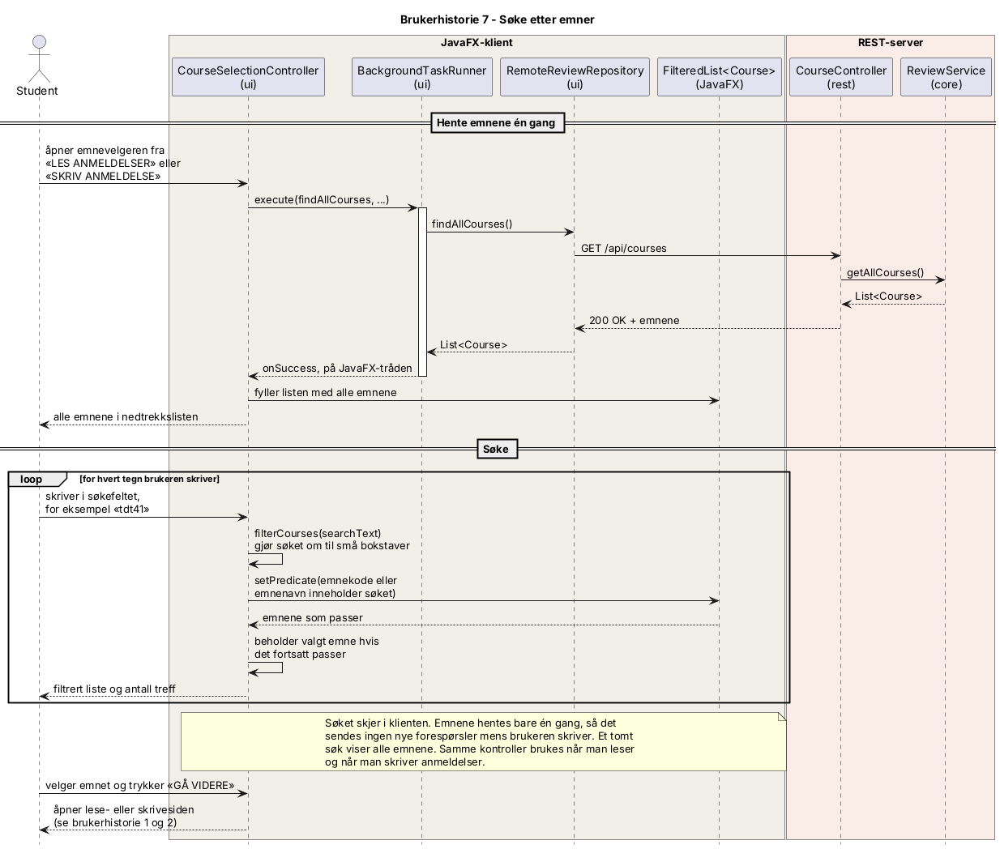

# BIThub - app for å skrive og lese anmeldelser av BIT fag

## Hva er BIThub?

BIThub gjør det mulig for studenter ved BIT (Bachelor i informatikk) å skrive offentlige anmeldelser av emner de har tatt. Hensikten med appen er at studenter skal kunne dele erfaringene sine med ulike emner, slik at andre studenter og forelesere kan få nytte av dem (se [brukerhistoriene](#brukerhistorier)).

Hvordan du starter appen, står i [README.md](../README.md#kjøre-lokalt).

Når man åpner appen, kommer man til innloggingssiden. Der kan man logge inn, registrere en ny bruker eller fortsette som gjest. Fra hjemmesiden kan man velge mellom å lese anmeldelser, skrive en anmeldelse og se egne anmeldelser.

<table>
  <tr>
    <td align="center"></td>
    <td align="center"></td>
    <td align="center"></td>
  </tr>
</table>

## Funksjonalitet

**Lese anmeldelser:**\
Man velger et emne fra listen over alle emnene i studieplanen, eller søker det opp med emnekode eller navn. Deretter ser man anmeldelsene av emnet, antall anmeldelser og gjennomsnittlig vurdering, både som stjerner og som tall. Gjester kan også lese anmeldelser.

**Skrive anmeldelse:**\
Man velger emne på samme måte som når man leser. Deretter gir man emnet fra en til fem stjerner, skriver en kommentar hvis man vil, og velger om anmeldelsen skal være anonym. Man må være logget inn for å skrive en anmeldelse, og hver bruker kan skrive en anmeldelse per emne.

**Mine anmeldelser:**\
Her ser man anmeldelsene man har skrevet selv, også de anonyme. Man kan endre vurderingen, kommentaren og om anmeldelsen er anonym, eller slette anmeldelsen.

**Profil:**\
Profilsymbolet øverst til høyre åpner profilsiden fra alle sidene inne i appen. Der ser man navnet og e-posten sin, og kan endre navn og passord og logge ut. E-posten kan ikke endres.

Informasjon om appen finnes via lenken «Mer info om appen her.» nederst på innloggingssiden og hjemmesiden.

## Anonyme anmeldelser og gjesteanmeldelser

Begge typene vises uten navn, men de er ikke det samme:

- **Anonyme anmeldelser** vises som «Anonym», men har en eier. Serveren lagrer hvem som skrev anmeldelsen, slik at eieren kan endre og slette den. E-posten til eieren sendes aldri ut fra serveren.
- **Gjesteanmeldelser** er gamle anmeldelser fra release 2, da man kunne skrive anmeldelser uten å logge inn. De vises som «Gjest», har ingen eier og kan ikke endres eller slettes av noen. Det blir ikke laget nye gjesteanmeldelser.

Mer om dette står i [release3.md](../docs/release3/release3.md#anonyme-anmeldelser-og-gjesteanmeldelser).

## Brukerhistorier

Hver brukerhistorie har et kort bakgrunnsavsnitt, flyten i appen og kriteriene vi brukte for å si at den var ferdig.
Alle brukerhistoriene har et sekvensdiagram som viser hva som skjer i klienten, hvilke REST-kall som sendes og hva
serveren gjør.

### 1. Skrive en anmeldelse

> Som student, skal jeg kunne skrive anmeldelser av fag, for å kunne hjelpe andre studenter med for eksempel å velge
> riktig valgfag for dem.

**Bakgrunn:** Studenter vet mye om et emne etter å ha tatt det, men det finnes ikke noe sted å dele det med dem som
skal velge emner senere.

**Flyt i appen:**
1. Brukeren logger inn og trykker «SKRIV ANMELDELSE» på hjemmesiden.
2. Brukeren søker opp emnet og trykker «GÅ VIDERE».
3. Brukeren gir en til fem stjerner, skriver eventuelt en kommentar og velger om anmeldelsen skal være anonym.
4. «SEND INN» sender anmeldelsen til serveren, og appen bekrefter at den ble lagret.

**Ferdig når:**
- Man må være logget inn for å skrive.
- Vurderingen må være mellom en og fem stjerner, ellers vises en feilmelding og skjemaet beholdes.
- Hver bruker kan skrive én anmeldelse per emne.
- Appen bekrefter at anmeldelsen ble sendt, og den vises for alle under emnet.

#### Sekvensdiagram for brukerhistorie 1

Kildefil: [`arkitektur/brukerhistorie1Sekvensdiagram.puml`](../arkitektur/brukerhistorie1Sekvensdiagram.puml)

[`WriteReviewController`](ui/src/main/java/ui/controller/WriteReviewController.java) kjenner bare
[`ReviewService`](core/src/main/java/core/service/ReviewService.java), som validerer anmeldelsen i `core` før den
sendes. I klienten lagrer `ReviewService` gjennom
[`RemoteReviewRepository`](ui/src/main/java/ui/client/RemoteReviewRepository.java), som sender
`POST /api/courses/{code}/reviews` til serveren. Serveren validerer på nytt og lagrer anmeldelsen i JSON-filen med
[`ReviewHandler`](file/src/main/java/file/ReviewHandler.java).

### 2. Lese anmeldelser av et emne

> Som foreleser, skal jeg kunne lese anmeldelser av faget jeg har, for å kunne forbedre og tilpasse faget til neste år.

**Bakgrunn:** Emneevalueringer kommer sent og har få svar. Anmeldelsene gir foreleseren tilbakemeldinger fortløpende.

**Flyt i appen:**
1. Brukeren trykker «LES ANMELDELSER» på hjemmesiden. Det går også uten å logge inn.
2. Brukeren søker opp emnet og trykker «GÅ VIDERE».
3. Appen viser gjennomsnittlig vurdering som stjerner og tall, antall anmeldelser og alle anmeldelsene.

**Ferdig når:**
- Gjennomsnittet og antallet stemmer med anmeldelsene som vises.
- Et emne uten anmeldelser viser «Ingen anmeldelser ennå.» i stedet for en feil.
- Anonyme anmeldelser viser ikke hvem som skrev dem.

#### Sekvensdiagram for brukerhistorie 2

Kildefil: [`arkitektur/brukerhistorie2Sekvensdiagram.puml`](../arkitektur/brukerhistorie2Sekvensdiagram.puml)

Den samme emnevelgeren brukes for lesing og skriving.
[`Navigation`](ui/src/main/java/ui/Navigation.java) bestemmer hvilken side som åpnes når et emne er valgt.
[`ReadReviewsController`](ui/src/main/java/ui/controller/ReadReviewsController.java) henter emnet med
`ReviewService.getCourseWithReviews`, som går gjennom `RemoteReviewRepository` og `GET /api/courses/{code}`.
Gjennomsnittet regnes ut i [`Course`](core/src/main/java/core/model/Course.java), så kontrolleren viser bare tallet.

### 3. Vurdere studiet før man begynner

> Som mulig fremtidig informatikkstudent, skal jeg kunne lese anmeldelsene av fagene, for å kunne se om dette er noe
> jeg har lyst å studere.

**Bakgrunn:** Den som vurderer å søke studiet, har ingen konto og vil bare se hvordan emnene er.

**Flyt i appen:** Brukeren trykker «Fortsett som gjest» på innloggingssiden og leser anmeldelser som i brukerhistorie 2.

**Ferdig når:**
- Gjester kan lese alle anmeldelsene uten å lage konto.
- Gjester kan logge inn eller registrere seg senere fra hjemmesiden.

#### Sekvensdiagram for brukerhistorie 3

Kildefil: [`arkitektur/brukerhistorie3Sekvensdiagram.puml`](../arkitektur/brukerhistorie3Sekvensdiagram.puml)

[`HomeController`](ui/src/main/java/ui/controller/HomeController.java) spør
[`UserSession`](ui/src/main/java/ui/session/UserSession.java) om brukeren er logget inn, og skjuler knappene for å
skrive og se egne anmeldelser for gjester. Lesing krever ikke innlogging, så `RemoteReviewRepository` sender
`GET /api/courses/{code}` uten token. Prøver noen likevel å sende en anmeldelse uten token, for eksempel med curl,
svarer [`ReviewController`](springboot/restserver/src/main/java/rest/api/ReviewController.java) med 401.

### 4. Lage konto og logge inn

> Som student, skal jeg kunne opprette en bruker og logge inn, for å kunne skrive, endre og slette egne anmeldelser
> uten at andre kan endre på dem.

**Bakgrunn:** For at bare den som skrev en anmeldelse skal kunne endre den, må appen vite hvem som er logget inn.

**Flyt i appen:**
1. Brukeren trykker «Registrer ny bruker» og fyller inn navn, e-post og passord.
2. Brukeren blir logget inn med en gang og kommer til hjemmesiden.
3. Neste gang logger brukeren inn med e-post og passord.

**Ferdig når:**
- Samme e-post kan ikke registreres to ganger.
- Passordet lagres ikke i klartekst på serveren.
- Feil e-post eller passord gir en feilmelding.

#### Sekvensdiagram for brukerhistorie 4

Kildefil: [`arkitektur/brukerhistorie4Sekvensdiagram.puml`](../arkitektur/brukerhistorie4Sekvensdiagram.puml)

[`RegisterUserController`](ui/src/main/java/ui/controller/RegisterUserController.java) og
[`LoginController`](ui/src/main/java/ui/controller/LoginController.java) sender `POST /api/users` og
`POST /api/login` gjennom [`RemoteAuthenticationClient`](ui/src/main/java/ui/client/RemoteAuthenticationClient.java)
i bakgrunnen. På serveren lager [`UserService`](core/src/main/java/core/service/UserService.java) brukeren, og
[`PasswordHasher`](core/src/main/java/core/service/PasswordHasher.java) lagrer bare salt og hash. En e-post som
allerede er registrert, gir 409, og feil passord gir 401. Ved suksess får klienten et token, som `UserSession` gir
videre til `RemoteReviewRepository`, slik at det sendes med alle kall som krever innlogging.

### 5. Endre og slette egne anmeldelser

> Som student, skal jeg kunne se, endre og slette egne anmeldelser, for å holde anmeldelsene mine oppdaterte og
> relevante for andre studenter.

**Bakgrunn:** Meningen om et emne kan endre seg, og da skal man kunne rette anmeldelsen i stedet for å skrive en ny.

**Flyt i appen:**
1. Brukeren trykker «MINE ANMELDELSER» og ser alle anmeldelsene sine, også de anonyme.
2. «ENDRE» åpner anmeldelsen, der man kan endre stjerner, kommentar og anonymitet.
3. «SLETT» sletter anmeldelsen.

**Ferdig når:**
- Man ser bare sine egne anmeldelser.
- Serveren avviser endring og sletting av andres anmeldelser.

#### Sekvensdiagram for brukerhistorie 5

Kildefil: [`arkitektur/brukerhistorie5Sekvensdiagram.puml`](../arkitektur/brukerhistorie5Sekvensdiagram.puml)

[`MyReviewsController`](ui/src/main/java/ui/controller/MyReviewsController.java) henter anmeldelsene med
`GET /api/me/reviews`. Serveren finner e-posten ut fra tokenet, så man får bare sine egne anmeldelser.
[`EditReviewController`](ui/src/main/java/ui/controller/EditReviewController.java) sender `PUT /api/reviews/{id}`, og
sletting sender `DELETE /api/reviews/{id}`. [`OwnReviewController`](springboot/restserver/src/main/java/rest/api/OwnReviewController.java)
lar `ReviewService` sjekke at anmeldelsen tilhører brukeren før den endres eller slettes, ellers svarer serveren 403.

### 6. Profil og passord

> Som registrert bruker, skal jeg kunne se profilen min og endre passordet mitt, for å kunne bytte til et sikrere
> passord hvis jeg tror noen andre kjenner det.

**Bakgrunn:** Brukeren må kunne holde kontoen sin trygg og oppdatert uten hjelp fra oss.

**Flyt i appen:**
1. Profilsymbolet øverst til høyre åpner profilsiden, som viser navn og e-post.
2. «ENDRE PASSORD» ber om det gamle og det nye passordet.
3. «ENDRE NAVN» endrer navnet, også på anmeldelsene med navn.
4. «LOGG UT» logger ut.

**Ferdig når:**
- Det gamle passordet må være riktig for å bytte.
- Det nye navnet vises på brukerens anmeldelser med navn.

#### Sekvensdiagram for brukerhistorie 6

Kildefil: [`arkitektur/brukerhistorie6Sekvensdiagram.puml`](../arkitektur/brukerhistorie6Sekvensdiagram.puml)

[`ChangePasswordController`](ui/src/main/java/ui/controller/ChangePasswordController.java) sjekker skjemaet før
`PUT /api/users/{email}/password` sendes. [`UserController`](springboot/restserver/src/main/java/rest/api/UserController.java)
svarer 403 hvis e-posten i stien ikke er brukerens egen, og 400 hvis det gamle passordet er feil. Når navnet endres
fra [`ProfileController`](ui/src/main/java/ui/controller/ProfileController.java), oppdaterer serveren både brukeren og
anmeldelsene med navn. Ved utlogging fjernes tokenet i klienten først, og så sendes `POST /api/logout`.

### 7. Søke etter emner

> Som student, skal jeg kunne søke etter fag med fagkode eller navn, for å raskt finne faget jeg vil lese eller skrive
> anmeldelser om.

**Bakgrunn:** Studieplanen har mange emner, så det tar tid å bla seg fram i en lang liste.

**Flyt i appen:** Brukeren skriver i søkefeltet når et emne skal velges, og listen filtreres mens man skriver.

**Ferdig når:**
- Søket treffer både emnekode og emnenavn, uansett store og små bokstaver.
- Et tomt søk viser alle emnene.
- Det samme søkefeltet brukes når man leser og skriver.

#### Sekvensdiagram for brukerhistorie 7

Kildefil: [`arkitektur/brukerhistorie7Sekvensdiagram.puml`](../arkitektur/brukerhistorie7Sekvensdiagram.puml)

[`CourseSelectionController`](ui/src/main/java/ui/controller/CourseSelectionController.java) henter alle emnene med
`GET /api/courses` én gang når siden åpnes. Søket filtrerer listen i klienten med en `FilteredList`, så det sendes
ingen nye forespørsler mens brukeren skriver.
