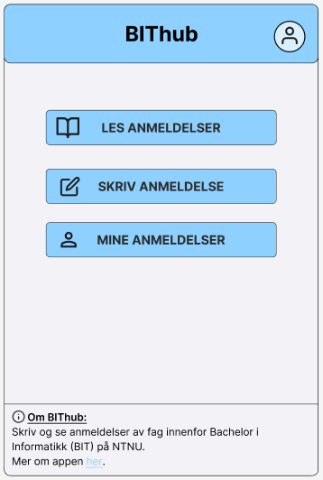
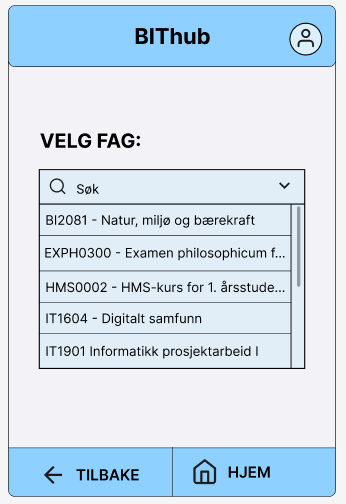
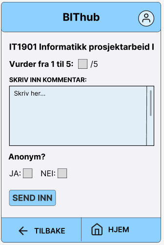
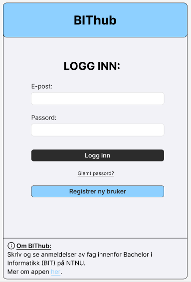

# Persistens og filformat

Dette dokumentet beskriver hvordan data lagres i applikasjonen, samt
strukturen på filformatet som brukes for persistens med JSON og Jackson.

## 1. Dokumentasjon av filformat

For å lagre applikasjonsdata, som kurs, anmeldelser og brukerdata, har vi
valgt å bruke **JSON** (JavaScript Object Notation) i kombinasjon med
**Jackson**-biblioteket i Java.

* **Hvorfor JSON?** JSON er et menneskevennlig, standardisert og lettleselig
  format som passer godt til objektorienterte datastrukturer. Det gjør det
  enkelt å serialisere DTO-er, som `CourseDTO` og `UserDTO`, direkte til fil
  og deserialisere dem tilbake til Java-objekter.

### 1.1 Kurs og anmeldelser

Kurs og anmeldelser lagres som en JSON-liste (`array`) der hvert element
representerer et kurs (`CourseDTO`).

Hvert kurs inneholder en emnekode (`courseCode`), et emnenavn (`courseName`)
og en liste over tilhørende anmeldelser (`reviews`).

Hver anmeldelse inneholder informasjon om hvem som har skrevet den
(`reviewerName`), en tallkarakter (`rating`) og en tekstkommentar (`comment`).

#### Eksempel på filstruktur for kurs og anmeldelser

```json
[
  {
    "courseCode": "IT1901",
    "courseName": "Informatikk prosjektarbeid",
    "reviews": [
      {
        "reviewerName": "Student",
        "rating": 2,
        "comment": "KOMMENTAR"
      },
      {
        "reviewerName": "Anonym",
        "rating": 4,
        "comment": "KOMMENTAR"
      }
    ]
  },
  {
    "courseCode": "TDT4100",
    "courseName": "Objektorientert programmering",
    "reviews": [
      {
        "reviewerName": "Anonym",
        "rating": 3,
        "comment": "KOMMENTAR"
      }
    ]
  }
]

```
### 1.2 Brukerdata

Brukerdata lagres i en egen JSON-fil. Hver bruker representeres av en
`UserDTO`, som inneholder navn (`name`), e-postadresse (`email`) og passord
(`password`).

`UserHandler` håndterer lesing og skriving av brukerdata ved hjelp av Jackson.
Dersom filen ikke finnes eller er tom, returneres en tom liste. Ved skriving
opprettes lagringsmappen automatisk dersom den ikke allerede finnes.

Standard lagringsplassering for brukerdata er `.bithub/users.json` i
brukerens hjemmemappe.

#### Eksempel på filstruktur (`users.json`)

```json
[
  {
    "name": "Stine Sørnes",
    "email": "stine@example.com",
    "password": "password123"
  },
  {
    "name": "Ola Nordmann",
    "email": "ola@example.com",
    "password": "anotherPassword"
  }
]

```


## 2. Lagringsmodell: Dokumentmetafor vs. implisitt lagring

I prosjektet har vi drøftet og valgt mellom to ulike prinsipper for hvordan applikasjonen håndterer filbehandling og brukerinteraksjon: **dokumentmetafor** og **implisitt lagring**.

### 2.1 Teoretisk sammenligning

* **Dokumentmetafor (Desktop-modell):** Brukeren har eksplisitt kontroll over filhåndteringen, tilsvarende klassiske skrivebordsapplikasjoner. Brukeren må aktivt åpne, lagre og opprette filer via fildialoger (`FileChooser`), og data i minnet går tapt dersom det ikke lagres før applikasjonen lukkes.

* **Implisitt lagring (App-modell):** Filhåndteringen skjules helt for brukeren. Applikasjonen har selv ansvar for å lese og skrive data automatisk til faste plasseringer i bakgrunnen ved oppstart og endringer i tilstand.

### 2.2 Vårt valg og begrunnelse med referanse til brukergrensesnittet

Vi har valgt **implisitt lagring** fremfor en tradisjonell dokumentmetafor. Valget er forankret i designet og brukermodellen som er definert i Figma-prototypen:

* **Sømløs navigasjon og brukeropplevelse:** Som vist på skjermbildene nedenfor (*Hjem skjerm* og *Velg fag*), er applikasjonen bygget opp som en navigasjonsbasert plattform. Brukeren navigerer via knapper som «LES ANMELDELSER» og «SKRIV ANMELDELSE». Å kreve at brukeren må åpne en `.json`-fil manuelt fra filsystemet for å lese eller skrive anmeldelser ville brutt med applikasjonens intenderte flyt.

<figure>
  
  <figcaption><em>Figur 2.1: Hjem-skjerm med navigasjonsknapper for lesing, skriving og egne anmeldelser.</em></figcaption>
</figure>

<figure>
  
  <figcaption><em>Figur 2.2: Fagutvalg der data hentes og visning oppdateres automatisk.</em></figcaption>
</figure>


* **Skjulmating av filhåndtering:** I skjermbildet *Skrive anmeldelse* benyttes dedikerte knapper som `SEND INN`. Når brukeren trykker på denne, håndteres skriveoperasjonen automatisk mot filsystemet i bakgrunnen uten at brukeren blir spurt om filsti eller filnavn.

<figure>
  
  <figcaption><em>Figur 2.3: Innsending av anmeldelse hvor data lagres i bakgrunnen ved trykk på «SEND INN».</em></figcaption>
</figure>


* **Bruker- og tilstandshåndtering:** Skjermbildene for innlogging, registrering og profil viser at brukeren forholder seg til sin egen konto og sine data. Persistenslaget håndterer automatisk opprettelse og oppdatering av brukerdata under `.bithub/users.json` i bakgrunnen.

<figure>
  
  <figcaption><em>Figur 2.4: Brukergrensesnitt for innlogging.</em></figcaption>
</figure>


### 2.3 Egenrefleksjon og begrensninger ved valgt modell

Selv om implisitt lagring er det mest hensiktsmessige valget for applikasjonens grensesnitt, er det viktig å belyse noen tekniske begrensninger i forhold til brukergrensesnittet i Figma:

* **Handlingstrigget lagring fremfor kontinuerlig auto-lagring:** Lagringen i grensesnittet er «handlingstrigget implisitt». Filbehandlingen skjules helt for brukeren, men selve skriveoperasjonen utløses eksplisitt ved trykk på knapper som `SEND INN` (*Skrive anmeldelse*) og `LAG NY BRUKER` (*Registrer ny bruker*).
* **Lokal JSON-persistens vs. sky-basert brukermodell:** Grensesnittet på *Logg inn side* og *Profil* gir brukeren en mental modell av en sentralisert sky-tjeneste der man kan logge inn fra hvilken som helst enhet. Siden nåværende persistenslag lagrer data i lokale JSON-filer under `.bithub/` i brukerens hjemmemappe, er dataene avgrenset til den enkelte datamaskinen. Dette er en kjent begrensning ved lokal fil-persistens som ville krevd en ekstern database/REST-API for fullstendig å matche brukermodellen i Figma.