# Dokumentasjon for release 2

Denne filen forklarer hva vi har gjort i release 2, hvilke valg vi har tatt og hvilke utfordringer vi hadde underveis. Noen temaer er beskrevet mer detaljert i egne filer:

- [persistence.md](persistence.md) – filformat og valget mellom dokumentmetafor og implisitt lagring
- [code-quality.md](code-quality.md) – testing, JaCoCo, Checkstyle og SpotBugs
- [work-practices.md](work-practices.md) – arbeidsvaner og parprogrammering
- [workflow.md](workflow.md) – issues, brancher, commit-meldinger, pull requests og code review
- [ai-tools.md](ai-tools.md) – bruk av KI i release 2
- [teamwork.md](teamwork.md) – refleksjon rundt samarbeidet i gruppen

Beskrivelse av appen, Figma-skisser og brukerhistorier finnes i [bithub/README.md](/bithub/README.md).

## Mål for release 2

I release 2 var hovedmålet å dele opp prosjektet i moduler og få på plass en tre-lags arkitektur, uten å miste noe av det vi hadde fra release 1. Vi ville heller ha en app der lagene fungerer godt sammen og alt er testet, enn mange nye funksjoner.

Målene våre var:

- [x] Dele opp prosjektet i modulene `core`, `file` og `ui`, med egen `pom.xml` og `module-info.java` for hver modul
- [x] Samle felles versjoner og plugins i rot-`pom.xml`
- [x] Bytte fra CSV til JSON med Jackson, i en egen modul for lagring
- [x] Dokumentere filformatet og velge mellom dokumentmetafor og implisitt lagring
- [x] Holde domenelaget uavhengig av lagringen
- [x] Flytte validering av anmeldelser fra kontrolleren til domenelaget
- [x] Koble logikk til «Velg fag»-siden og hjemmesiden
- [x] Samle navigasjonen mellom sidene i én klasse
- [x] Lage en klasse for brukere og lagre dem til fil
- [x] Lese anmeldelser for et emne, med gjennomsnittlig vurdering og antall anmeldelser
- [x] Tester i alle modulene, med høy testdekning fra JaCoCo
- [x] Checkstyle og SpotBugs som kjøres av Maven
- [x] Skrive ned arbeidsflyt, arbeidsvaner og valg for kodekvalitet
- [x] Dokumentere arkitekturen med et diagram
- [ ] Innlogging og registrering i appen

Vi er fornøyde med arkitekturen og kodekvaliteten. Med lesing og skriving av anmeldelser går data nå begge veier gjennom alle tre lagene. Innlogging prioriterte vi ned, ettersom hovedmålet var å opprettholde kvalitet før eventuelt nye funksjoner legges til. 

## Funksjonalitet i release 2

Dette fungerer i appen nå:

- [Hjemmeside](/bithub/ui/src/main/resources/ui/Hjemmeside.fxml) med knapper til de ulike delene av appen
- [Velg fag](/bithub/ui/src/main/resources/ui/VelgFag.fxml) med en nedtrekksliste over emner. Den samme siden brukes både når man skal skrive og lese anmeldelser.
- [Skrive anmeldelse](/bithub/ui/src/main/resources/ui/SkrivAnmeldelse.fxml) med vurdering fra 1–5, kommentar og mulighet til å være anonym
- [Lese anmeldelser](/bithub/ui/src/main/resources/ui/LeseAnmeldelser.fxml) for et emne, med alle anmeldelsene, gjennomsnittlig vurdering og antall anmeldelser
- Validering i [ReviewService](/bithub/core/src/main/java/core/ReviewService.java) i domenelaget, med feilmeldinger som vises i appen
- Anmeldelser lagres automatisk til en JSON-fil, sortert per emne
- En [User](/bithub/core/src/main/java/core/User.java)-klasse som sjekker navn, e-post og passord, og som lagres med [UserHandler](/bithub/file/src/main/java/file/UserHandler.java)

Knappene «Mine anmeldelser» og «Profil» åpner foreløpig bare en side der det står «Denne siden er ikke laget ennå». Brukere kan lagres til fil, men det er ikke koblet til appen ennå.

## Bilder fra appen

Trykk på et bilde for å åpne det i full størrelse i mappen [bilder_release2](bilder_release2/).

### Sider i bruk

Disse sidene er koblet sammen i appen. Man starter på hjemskjermen og velger fag. Via «Skriv anmeldelse» kommer man til skjemaet, og via «Les anmeldelser» kommer man til anmeldelsene for faget.

<table>
  <tr>
    <td align="center">
      <b>Hjem skjerm</b><br>
      <a href="bilder_release2/Hjemmeside.png">
        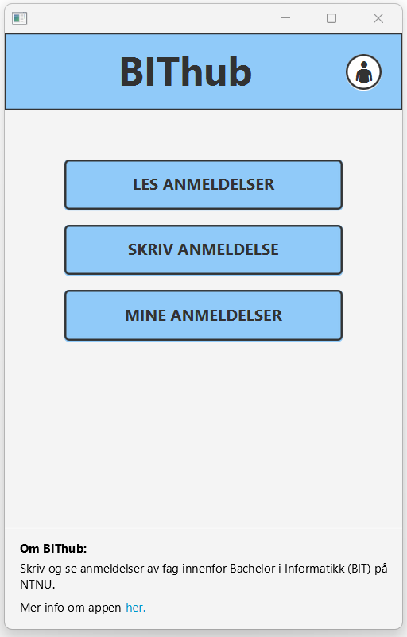
      </a>
    </td>
    <td align="center">
      <b>Velg fag</b><br>
      <a href="bilder_release2/VelgFag.png">
        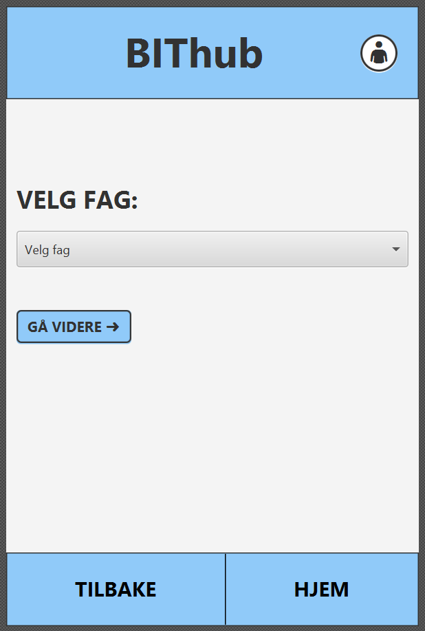
      </a>
    </td>
    <td align="center">
      <b>Skrive anmeldelse</b><br>
      <a href="bilder_release2/SkrivAnmeldelse.png">
        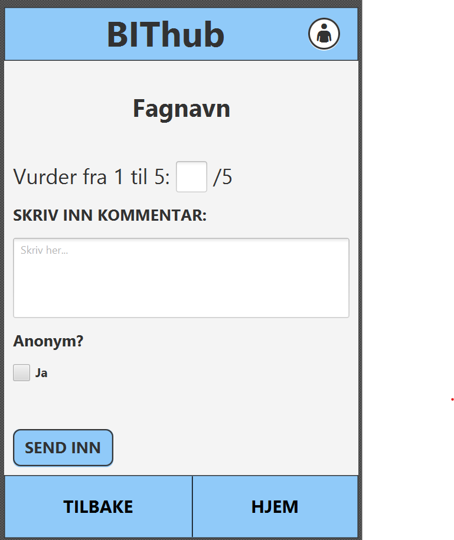
      </a>
    </td>
  </tr>
</table>

<table>
  <tr>
    <td align="center">
      <b>Anmeldelsen er sendt inn</b><br>
      <a href="bilder_release2/AnmeldelseSendt.png">
        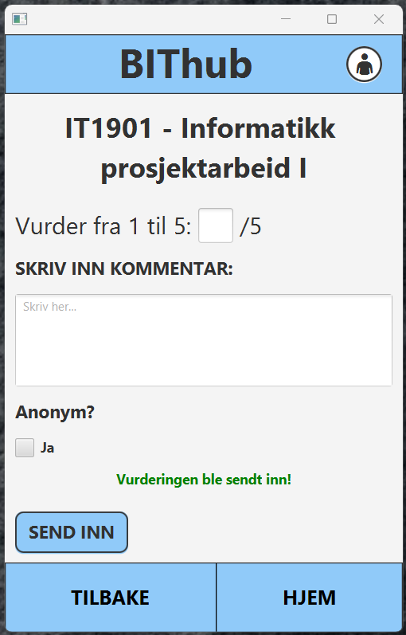
      </a>
    </td>
    <td align="center">
      <b>Lese anmeldelser</b><br>
      <a href="bilder_release2/LeseAnmeldelser.png">
        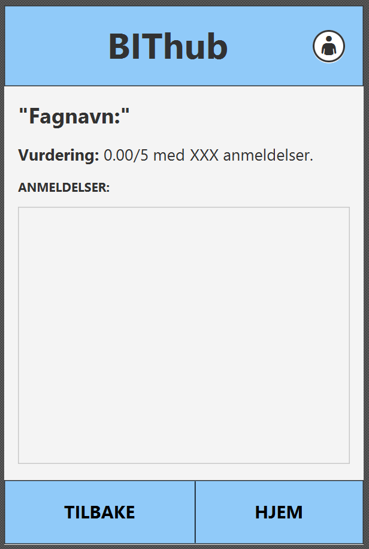
      </a>
    </td>
    <td align="center">
      <b>Emne uten anmeldelser</b><br>
      <a href="bilder_release2/EmneUtenAnmeldelse.png">
        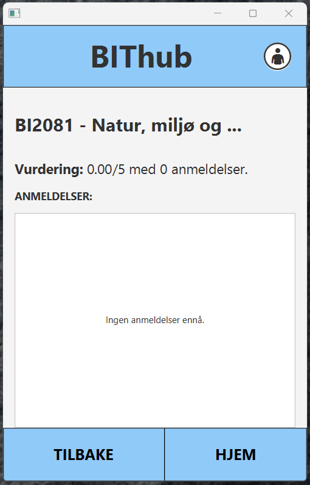
      </a>
    </td>
  </tr>
</table>

### Sider som ikke er i bruk ennå

Disse sidene er laget i FXML, men er ennå ikke koblet til navigasjonen i appen.

<table>
  <tr>
    <td align="center">
      <b>Logg inn</b><br>
      <a href="bilder_release2/LoggInn.png">
        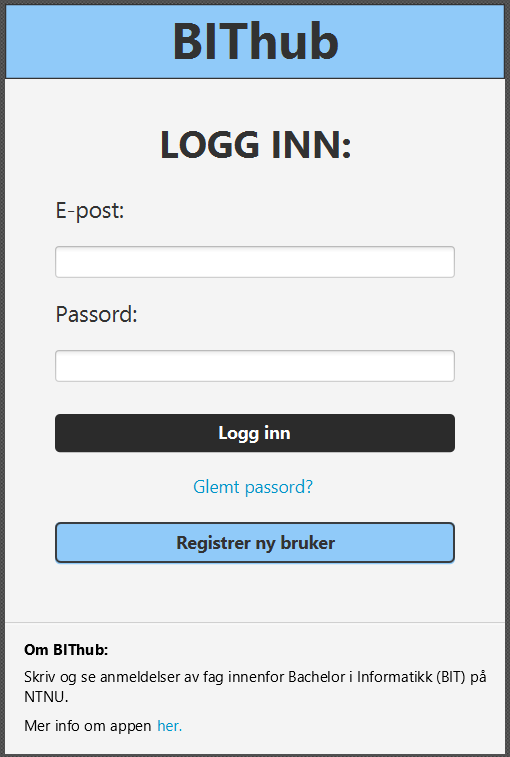
      </a>
    </td>
    <td align="center">
      <b>Registrer ny bruker</b><br>
      <a href="bilder_release2/RegistrerBruker.png">
        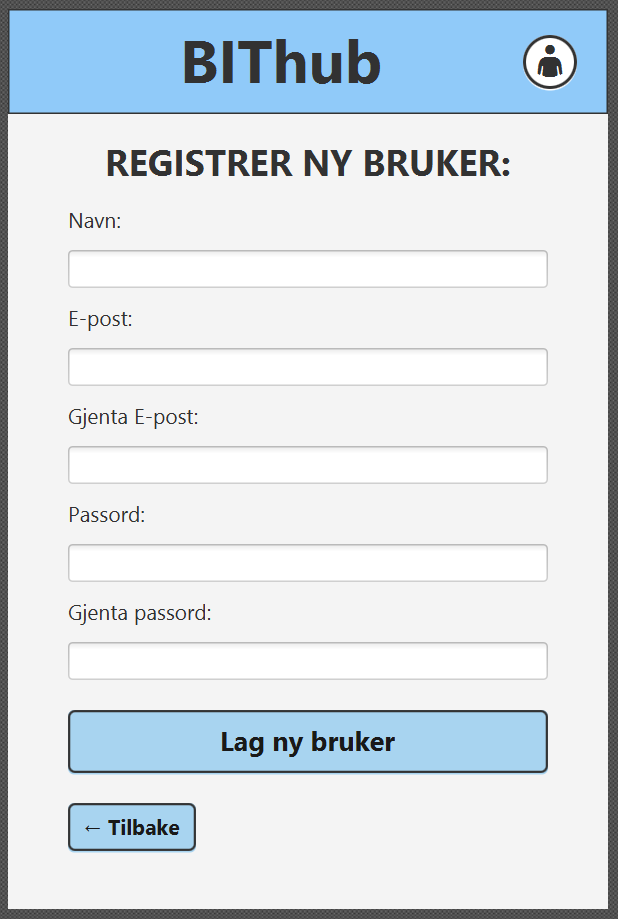
      </a>
    </td>
  </tr>
</table>

<table>
  <tr>
    <td align="center">
      <b>Info om appen</b><br>
      <a href="bilder_release2/InfoOmBIThub.png">
        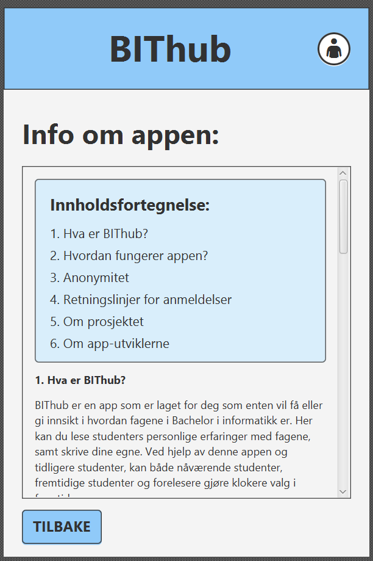
      </a>
    </td>
    <td align="center">
      <b>Profil side</b><br>
      <a href="bilder_release2/Profil.png">
        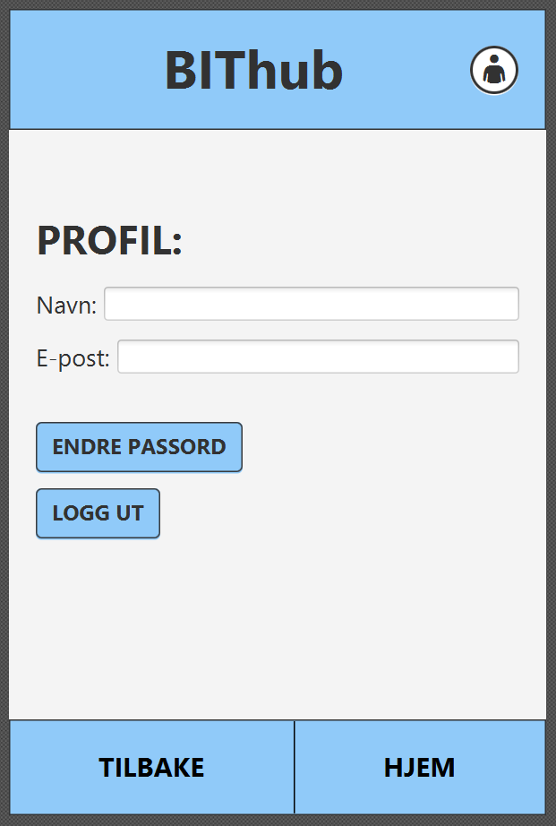
      </a>
    </td>
    <td align="center">
      <b>Endre passord</b><br>
      <a href="bilder_release2/EndrePassord.png">
        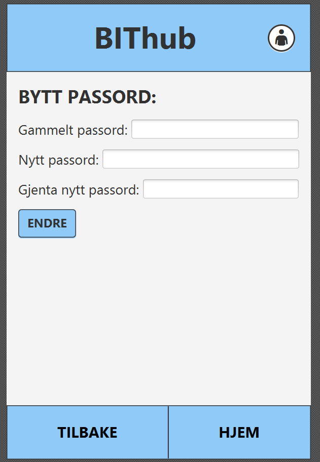
      </a>
    </td>
  </tr>
</table>

<table>
  <tr>
    <td align="center">
      <b>Mine anmeldelser</b><br>
      <a href="bilder_release2/MineAnmeldelser.png">
        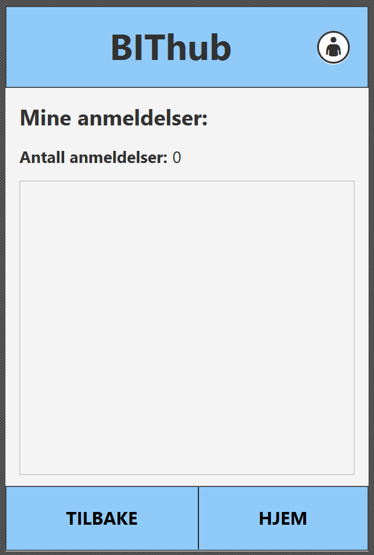
      </a>
    </td>
    <td align="center">
      <b>Endre egen anmeldelse</b><br>
      <a href="bilder_release2/EndreEgenAnmeldelse.png">
        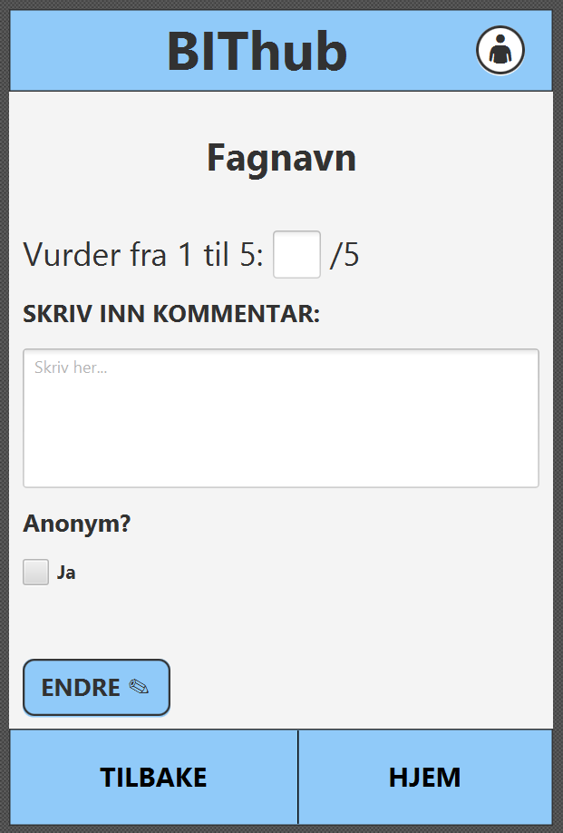
      </a>
    </td>
  </tr>
</table>

## Arkitektur

Prosjektet består av tre Maven-moduler, og hver av dem er også en Java-modul med egen `module-info.java`:

| Maven-modul | Java-modul | Hva den inneholder |
| --- | --- | --- |
| `core` | `bithub.core` | Domenelogikken: `Course`, `Review`, `User`, `ReviewService` og grensesnittet `ReviewRepository` |
| `file` | `bithub.file` | Lagring til JSON med Jackson: `ReviewHandler`, `UserHandler` og DTO-klassene |
| `ui` | `bithub.ui` | JavaFX-appen: `App`, kontrollerne, `Navigation` og FXML-filene |

`ui` avhenger av `core` og `file`, og `file` avhenger av `core`. `core` avhenger ikke av noen av de andre modulene.

### Hvordan lagene henger sammen

Når brukeren trykker «SEND INN», kaller `SkrivAnmeldelseController` på `submitReview` i `ReviewService`. Der sjekkes det at det som er skrevet inn er gyldig, for eksempel at vurderingen er et tall fra 1 til 5. Er alt riktig, sendes anmeldelsen videre til et `ReviewRepository`.

Når brukeren skal lese anmeldelser, går det motsatt vei. `LeseAnmeldelserController` kaller på `getCourseWithReviews` i `ReviewService`, som henter emnet med `findCourse` i `ReviewRepository`. `ReviewHandler` leser JSON-filen og gjør `CourseDTO` om til et `Course`-objekt med anmeldelsene. Har ingen anmeldt emnet ennå, får kontrolleren et tomt emne tilbake. Gjennomsnittet regnes ut av `Course` i domenelaget.

`ReviewRepository` er et grensesnitt som ligger i `core`, men det er `ReviewHandler` i `file` som implementerer det. Da trenger ikke `core` å vite noe om JSON eller filer, og `core` blir ikke avhengig av `file`. Det er bare `App` som vet at vi bruker `ReviewHandler`, og den kobler det sammen når appen starter. Dette gjør det også lett å teste `ReviewService` uten ekte fillagring, og vi kan bytte ut lagringen senere, for eksempel med et REST-API.

`ui` avhenger av `file` bare fordi `App` må opprette `ReviewHandler`. Resten av `ui` bruker bare `core`. Vi så på om vi kunne fjerne denne avhengigheten helt, men valgte å prioritere det i neste release.

## Valg for release 2

I release 1 lagret vi anmeldelser i CSV med en `FileHandler` som lå i `core`. Nå har vi flyttet lagringen til en egen `file`-modul og byttet til JSON med Jackson. JSON passer bedre når et emne skal ha en liste med anmeldelser. Dataene lagres automatisk i `~/.bithub/`, så brukeren trenger aldri å velge fil selv. Filformatet og hvorfor vi valgte implisitt lagring står i [persistence.md](persistence.md).

Vi la grensesnittet `ReviewRepository` i `core` for at domenelaget ikke skal være avhengig av lagringen.

I release 1 lå navigasjonen spredt rundt i kontrollerne. Nå har vi samlet den i klassen `Navigation`, som også sender `ReviewService` videre til sidene som trenger den.

Da vi la til lesing av anmeldelser, valgte vi å bruke samme «Velg fag»-side som når man skriver. `Navigation` forteller fagvelgeren hva som skal skje når et fag er valgt: enten åpnes skjemaet for å skrive, eller siden for å lese. Slik slapp vi å lage en kopi av siden og kontrolleren.

Checkstyle og SpotBugs kjøres når man kjører `mvn verify`, og JaCoCo måler testdekningen for hver modul. Mer om innstillingene står i [code-quality.md](code-quality.md).

## Tester og testdekning

Alle modulene har tester. Testene kjøres fra prosjektmappen `bithub` med `mvn test`, og `mvn verify` kjører i tillegg Checkstyle og SpotBugs. JaCoCo lager en rapport for hver modul i `<modul>/target/site/jacoco/index.html`. I `core` og `file` bruker vi JUnit 5, og i `ui` bruker vi TestFX.

#### core

- [CourseTest](/bithub/core/src/test/java/core/CourseTest.java) og [ReviewTest](/bithub/core/src/test/java/core/ReviewTest.java) tester at emner og anmeldelser opprettes riktig og at ugyldige verdier blir avvist.
- [UserTest](/bithub/core/src/test/java/core/UserTest.java) tester at navn, e-post og passord sjekkes riktig.
- [ReviewServiceTest](/bithub/core/src/test/java/core/ReviewServiceTest.java) tester at gyldige anmeldelser blir lagret, at mellomrom fjernes fra input, og at tom, ugyldig eller for høy/lav vurdering blir avvist. Den tester også at `getCourseWithReviews` henter et emne med anmeldelser, og gir et tomt emne når ingen har anmeldt det. Her bruker vi en falsk `ReviewRepository`, så testen bare tester logikken i `core`.

#### file

- [ReviewHandlerTest](/bithub/file/src/test/java/file/ReviewHandlerTest.java) tester lesing og skriving av anmeldelser, at de havner på riktig emne, og hva som skjer med tomme filer og feil. Den tester også at `findCourse` finner riktig emne uansett store og små bokstaver, og gir et tomt svar for ukjente emner og når filen mangler.
- [ReviewStorageTest](/bithub/file/src/test/java/file/ReviewStorageTest.java) tester `ReviewService` og `ReviewHandler` sammen: at en anmeldelse som sendes inn faktisk havner i filen, og at ugyldige anmeldelser ikke blir lagret.
- [UserHandlerTest](/bithub/file/src/test/java/file/UserHandlerTest.java) tester lagring og lesing av brukere, at mapper opprettes, og hva som skjer ved ødelagt JSON og feil ved lesing/skriving.

#### ui

- [SkrivAnmeldelseControllerTest](/bithub/ui/src/test/java/ui/SkrivAnmeldelseControllerTest.java) tester skjemaet for å skrive anmeldelse: at riktig emne vises, at feilmeldinger kommer ved ugyldig vurdering, og at anmeldelsen lagres til fil både når man er anonym og ikke.
- [LeseAnmeldelserControllerTest](/bithub/ui/src/test/java/ui/LeseAnmeldelserControllerTest.java) tester siden for å lese anmeldelser: at anmeldelsene, gjennomsnittet og antallet vises riktig, at et emne uten anmeldelser viser «Ingen anmeldelser ennå.», og at TILBAKE og HJEM går til riktig side.
- [NewNavigationTest](/bithub/ui/src/test/java/ui/NewNavigationTest.java) tester at man kan gå fra hjemmesiden, velge fag, komme til skjemaet og tilbake igjen, og at sidene som ikke er laget ennå vises. Den har også en ende-til-ende-test som skriver en anmeldelse i appen og leser den tilbake på «Les anmeldelser»-siden, slik at alle tre lagene testes sammen.

Alle testene som skriver til fil, også UI-testene, bruker `@TempDir` fra JUnit, så de skriver aldri til den ekte `~/.bithub`-mappen.

| Modul | Instruksjonsdekning | Grendekning |
| --- | --- | --- |
| core | 100 % | 100 % |
| file | 99 % | 92 % |
| ui | 92 % | 81 % |

Ved innlevering av release 2 gir `mvn clean verify` ingen
Checkstyle-warnings og ingen SpotBugs-funn utover de dokumenterte
unntakene i [code-quality.md](code-quality.md).

## Arbeidsflyt og samarbeid

### Arbeidsflyt med Git

Vi har fortsatt med samme arbeidsflyt som i release 1, men denne gangen skrev vi den ned i [workflow.md](workflow.md), med maler for issues, branch-navn, commit-meldinger og pull requests. Alt arbeid starter med et issue som er knyttet til milepælen for release 2, og hvert issue får sin egen branch. Før vi lager en pull request, henter vi inn siste versjon av `master`, løser eventuelle konflikter lokalt og kjører `mvn clean verify`. Minst én annen på gruppen ser over endringene før de blir merget.

### Parprogrammering

I release 2 jobbet vi i par. Én skriver koden (driver), mens den andre følger med og kommer med innspill (navigator), og vi bytter roller underveis. Når vi har jobbet i par, skriver vi det i commit-meldingen med `Co-authored-by:`.

Parprogrammering var særlig nyttig på oppgaver som gikk på tvers av modulene. Da vi skulle finne ut hvordan `core` kunne lagre anmeldelser uten å bli avhengig av `file`, hjalp det mye å kunne diskutere det med noen før vi endte opp med grensesnittet `ReviewRepository`. Det samme gjaldt fillagringen i `file`. Der diskuterte vi ulike måter å lagre dataene på, og det å jobbe i par gjorde det lettere å komme fram til en løsning som også fungerer når appen skal utvides senere.

Mot slutten av release 2 oppdaget vi at `Co-authored-by` hadde
stått over issue-referansen (`ref`/`closes`) i commit-meldingene.
GitHub gjenkjenner bare medforfattere når linjen står helt nederst i
meldingen, så parprogrammeringen vises ikke på GitHub, selv om
medforfatterne står i commit-meldingene. Vi har rettet malen i
[workflow.md](workflow.md) og bruker riktig rekkefølge fra release 3.

Vi passet på at alle fikk jobbe sammen med alle på minst én oppgave. Det gjorde samarbeidet mye bedre i release 2.

### Møter og planlegging

Som i release 1 hadde vi møte én gang i uken, på tirsdager kl. 13:30. Der gikk vi gjennom hva hver enkelt hadde gjort, hva som gjensto og om noen satt fast. Vi fordelte issues for uken og bestemte hvem som skulle jobbe sammen på hva. Mer om hvordan samarbeidet fungerte står i [teamwork.md](teamwork.md).

## Utfordringer i release 2

Det tok en del tid å gå fra CSV til JSON. All fillagringen fra release 1 måtte skrives om og flyttes ut av `core`. Jackson trenger en tom konstruktør og settere for å lage objekter fra JSON. Først la vi det til i `Review`, men da kunne valideringen omgås. Vi lagde derfor egne DTO-klasser (`CourseDTO`, `ReviewDTO` og `UserDTO`) for hvordan dataene ser ut i filene, slik at `Review` kunne være uforanderlig.

Det var fristende å bare la `core` bruke `ReviewHandler` direkte, men da ville domenelaget blitt avhengig av lagringen. Løsningen ble å lage grensesnittet `ReviewRepository`.

Når forskjellige par jobbet på domenelaget, lagringen og brukergrensesnittet samtidig, måtte vi bli enige tidlig om hvordan delene skulle snakke sammen. Noen oppgaver ble forsinket fordi de var avhengige av noe som ikke var ferdig ennå, og vi ble etter hvert flinkere til å avklare dette før vi begynte å kode.


## Eksempeldata

I [eksempeldata/courses.json](eksempeldata/courses.json) ligger en fil med anmeldelser av tre emner. Den kan brukes til å prøve appen uten å skrive inn alt selv:

| Emne | Anmeldelser | Gjennomsnitt |
| --- | --- | --- |
| IT1901 Informatikk prosjektarbeid I | 3 | 4.00 |
| IT1604 Digitalt samfunn | 2 | 3.50 |
| EXPH0300 Examen philosophicum | 1 | 2.00 |
| BI2081 og HMS0002 | 0 | – |

Appen leser og skriver alltid til `courses.json` i mappen `.bithub` i hjemmemappen din. For å bruke eksempeldataene kopierer du filen dit før du starter appen. Har du allerede en `courses.json` der, ta en kopi av den først, for den blir overskrevet.

Fra rotmappen i repoet, på macOS og Linux:

```bash
mkdir -p ~/.bithub
cp docs/release2/eksempeldata/courses.json ~/.bithub/courses.json
```

På Windows (PowerShell):

```powershell
cd C:\sti\til\gr2610
New-Item -ItemType Directory -Force "$HOME\.bithub"
Copy-Item docs\release2\eksempeldata\courses.json "$HOME\.bithub\courses.json"
```

Start så appen som beskrevet i [README](/README.md). Bildene over er tatt med disse dataene, og du kan gjenskape dem slik:

1. Trykk «SKRIV ANMELDELSE», velg IT1901 og trykk «GÅ VIDERE».
2. Gi vurdering 4, skriv «Gode tilbakemeldinger fra læringsassistentene.», kryss av for anonym og trykk «SEND INN».
3. Trykk «HJEM», så «LES ANMELDELSER», og velg IT1901. Nå vises fire anmeldelser med gjennomsnitt 4.00.
4. Trykk «TILBAKE» og velg BI2081. Den har ingen anmeldelser ennå.