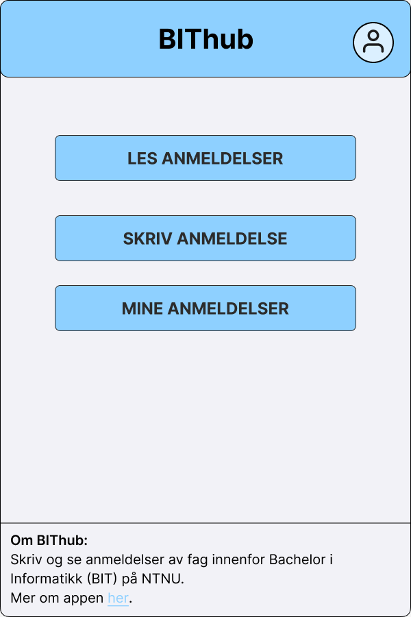

# Persistens og filformat

Her beskriver vi hvordan BIThub lagrer emner, anmeldelser og brukere, hvordan filene ser ut, og hvordan vi hindrer at data går tapt når flere forespørsler kommer samtidig eller skrivingen feiler.

Dokumentet bygger på [persistence.md fra release 2](../release2/persistence.md). Dette er endret siden da:

- Anmeldelser har fått id, eier og anonymitet (#142).
- Brukere lagres med passordhash og salt i stedet for passord i klartekst (#148).
- En lesefeil tolkes ikke lenger som en tom fil (#147).
- All lesing og skriving er beskyttet mot samtidige oppdateringer og skrivefeil (#149).
- [`UserHandler`](../../bithub/file/src/main/java/file/UserHandler.java) implementerer [`UserRepository`](../../bithub/core/src/main/java/core/repository/UserRepository.java) og kobles til [`UserService`](../../bithub/core/src/main/java/core/service/UserService.java) på REST-serveren (#155).
- Anmeldelser kan endres og slettes, og begge operasjonene er beskyttet mot samtidige oppdateringer (#177).
- JavaFX-appen leser og skriver ikke filene selv lenger. Den henter og lagrer alt gjennom REST-serveren med [`RemoteReviewRepository`](../../bithub/ui/src/main/java/ui/client/RemoteReviewRepository.java) (#172), og `ui` er ikke avhengig av `file` (#175). Bare serveren leser og skriver filene.
- Serveren legger til standardemnene som mangler, når den starter (#221).
- Når en bruker endrer navn, lagres brukeren på nytt med samme passordhash og salt i `users.json`, og navnet oppdateres i alle anmeldelsene brukeren eier i `courses.json` med [`updateReviewerName`](../../bithub/file/src/main/java/file/ReviewHandler.java#L288). Hver fil oppdateres under sin egen skrivelås. Feiler oppdateringen av anmeldelsene, setter [`UserController`](../../bithub/springboot/restserver/src/main/java/rest/api/UserController.java#L140) navnet tilbake, slik at brukeren og anmeldelsene ikke får forskjellige navn (#236).

## 1. Filformat

Vi lagrer data som **JSON** med biblioteket **Jackson**. JSON er standardisert og lett å lese, og passer godt til objekter med lister, for eksempel et emne med anmeldelser. Jackson gjør om mellom JSON og egne DTO-klasser ([`CourseDTO`](../../bithub/file/src/main/java/file/dto/CourseDTO.java), [`ReviewDTO`](../../bithub/file/src/main/java/file/dto/ReviewDTO.java) og [`UserDTO`](../../bithub/file/src/main/java/file/dto/UserDTO.java)). DTO-ene beskriver hvordan dataene ser ut i filene, slik at domeneklassene i `core` kan være uforanderlige og uavhengige av Jackson.

Som standard lagres dataene i mappen `.bithub` i hjemmemappen til brukeren som kjører programmet:

| Fil | Innhold | Klasse |
|---|---|---|
| `courses.json` | Emner med anmeldelser | [`ReviewHandler`](../../bithub/file/src/main/java/file/ReviewHandler.java) |
| `users.json` | Brukere med passordhash og salt | [`UserHandler`](../../bithub/file/src/main/java/file/UserHandler.java) |

Filene leses og skrives bare av modulen `file`. `core` kjenner bare grensesnittene [`ReviewRepository`](../../bithub/core/src/main/java/core/repository/ReviewRepository.java) og [`UserRepository`](../../bithub/core/src/main/java/core/repository/UserRepository.java), så lagringen kan byttes ut uten å endre `core`.

På REST-serveren oppretter [`RestApplication`](../../bithub/springboot/restserver/src/main/java/rest/RestApplication.java) en [`ReviewHandler`](../../bithub/file/src/main/java/file/ReviewHandler.java) og en [`UserHandler`](../../bithub/file/src/main/java/file/UserHandler.java), og gir dem til [`ReviewService`](../../bithub/core/src/main/java/core/service/ReviewService.java) og [`UserService`](../../bithub/core/src/main/java/core/service/UserService.java) gjennom Spring-beans. Filstiene kan overstyres med Spring-innstillingene `bithub.reviews-file` og `bithub.users-file`, for eksempel for å bruke egne testfiler.

Når serveren starter, legger den til standardemnene fra [`DefaultCourses`](../../bithub/core/src/main/java/core/service/DefaultCourses.java) som mangler i `courses.json` (#221). Emner og anmeldelser som finnes fra før, beholdes.

### 1.1 Emner og anmeldelser (`courses.json`)

Filen er en liste med emner ([`CourseDTO`](../../bithub/file/src/main/java/file/dto/CourseDTO.java)). Hvert emne har en emnekode (`courseCode`), et navn (`courseName`) og en liste med anmeldelser (`reviews`).

Hver anmeldelse ([`ReviewDTO`](../../bithub/file/src/main/java/file/dto/ReviewDTO.java)) har disse feltene:

| Felt | Innhold |
|---|---|
| `id` | Unik id (UUID), som brukes når anmeldelsen skal endres eller slettes |
| `ownerEmail` | E-posten til brukeren som skrev den, eller `null` for gjesteanmeldelser fra release 2 |
| `reviewerName` | Navnet til den som skrev den |
| `anonymous` | `true` hvis eieren vil være anonym |
| `rating` | Vurdering fra 1 til 5 |
| `comment` | Kommentar, kan være tom |

Ut fra `ownerEmail` og `anonymous` får anmeldelsen typen [`USER`](../../bithub/core/src/main/java/core/model/AuthorType.java#L9), [`ANONYMOUS`](../../bithub/core/src/main/java/core/model/AuthorType.java#L12) eller [`GUEST`](../../bithub/core/src/main/java/core/model/AuthorType.java#L15). E-posten til eieren lagres i filen, men skal ikke sendes ut i offentlige REST-svar (se [rest-api.md](rest-api.md)).

```json
[
  {
    "courseCode": "IT1901",
    "courseName": "Informatikk prosjektarbeid I",
    "reviews": [
      {
        "id": "b7e2c1d4-5f6a-4b3c-9d8e-1a2b3c4d5e6f",
        "ownerEmail": "kari@example.com",
        "reviewerName": "Kari Nordmann",
        "anonymous": false,
        "rating": 5,
        "comment": "Lærerikt og godt organisert."
      },
      {
        "id": "c8f3d2e5-6a7b-4c4d-8e9f-2b3c4d5e6f7a",
        "ownerEmail": "ola@example.com",
        "reviewerName": "Ola Nordmann",
        "anonymous": true,
        "rating": 4,
        "comment": "Mye arbeid, men verdt det."
      },
      {
        "id": "d9a4e3f6-7b8c-4d5e-9fa0-3c4d5e6f7a8b",
        "ownerEmail": null,
        "reviewerName": "Gjest",
        "anonymous": false,
        "rating": 3,
        "comment": "Greit emne."
      }
    ]
  }
]
```

### 1.2 Brukere (`users.json`)

Hver bruker ([`UserDTO`](../../bithub/file/src/main/java/file/dto/UserDTO.java)) har navn (`name`), e-post (`email`), passordhash (`passwordHash`) og salt (`salt`). Passordet lagres aldri i klartekst. Når en bruker lages, lages et tilfeldig salt på 16 byte, og passordet hashes med PBKDF2 (`PBKDF2WithHmacSHA256`) til 32 byte. Hash og salt lagres som Base64. Ved innlogging hashes passordet på nytt med samme salt og sammenlignes med den lagrede hashen.

```json
[
  {
    "name": "Kari Nordmann",
    "email": "kari@example.com",
    "passwordHash": "23SKf/jLMMug1kkBau2K7iiewfJMK/rKtYmGua1yHh8=",
    "salt": "4jPyTznUf4Qu1aoIQzde5Q=="
  }
]
```

[`UserService`](../../bithub/core/src/main/java/core/service/UserService.java) gjør e-postadresser om til små bokstaver og fjerner mellomrom rundt adressen før registrering og oppslag (#152). Dermed behandles `Kari@Example.com` og `kari@example.com` som samme adresse.

[`UserHandler`](../../bithub/file/src/main/java/file/UserHandler.java) gjør om mellom [`UserDTO`](../../bithub/file/src/main/java/file/dto/UserDTO.java) i filen og [`User`](../../bithub/core/src/main/java/core/model/User.java) i domenelaget. Ved lesing brukes den lagrede hashen og saltet til å gjenopprette brukeren, uten å hashe passordet på nytt.

## 2. Lagringsmodell: dokumentmetafor og implisitt lagring

### 2.1 Sammenligning

- **Dokumentmetafor:** Brukeren åpner, lagrer og oppretter filer selv med fildialoger, som i et tekstbehandlingsprogram. Data som ikke er lagret, går tapt når programmet lukkes.
- **Implisitt lagring:** Programmet leser og skriver data automatisk til faste steder. Brukeren ser aldri filene.

### 2.2 Vårt valg

Vi bruker fortsatt **implisitt lagring**, slik vi begrunnet i release 2. Appen er bygget rundt navigasjon med knapper som «LES ANMELDELSER» og «SKRIV ANMELDELSE», og brukeren skal aldri måtte velge en fil.

<figure>
  
  <figcaption><em>Figur 2.1: Hjem-skjerm med navigasjonsknapper for lesing, skriving og egne anmeldelser.</em></figcaption>
</figure>

- **Lesing:** Når brukeren velger et emne, hentes anmeldelsene i bakgrunnen og vises med gjennomsnitt og antall.
- **Skriving:** Når brukeren trykker «SEND INN», lagres anmeldelsen uten at brukeren blir spurt om filnavn.
- **Brukere:** Registrering gjennom [`UserService`](../../bithub/core/src/main/java/core/service/UserService.java) lagrer brukeren i `users.json`, og innlogging leser brukerdata fra samme fil.

I release 3 er lesing og skriving flyttet til REST-serveren. JavaFX-appen sender forespørsler, og serveren bruker [`ReviewHandler`](../../bithub/file/src/main/java/file/ReviewHandler.java) og [`UserHandler`](../../bithub/file/src/main/java/file/UserHandler.java) til å lese og skrive filene. For brukeren er lagringen fortsatt implisitt.

### 2.3 Begrensninger

- **Handlingsutløst lagring:** Data lagres når brukeren utfører en handling, for eksempel å sende inn en anmeldelse eller registrere en bruker, ikke fortløpende mens brukeren skriver.
- **Lokale filer:** Dataene ligger i filer på maskinen der serveren kjører. Med REST-serveren kan flere klienter dele samme data, men det er ingen ekte skytjeneste eller database.
- **Én serverprosess:** Beskyttelsen mot samtidige oppdateringer gjelder bare innenfor én prosess (se avsnitt 3.3).

Passord i klartekst var en begrensning i release 2. Den er løst med hash og salt i #148.

## 3. Sikker lagring

### 3.1 Samtidige oppdateringer

REST-serveren kan behandle flere forespørsler samtidig. En endring leser hele filen, endrer listen og skriver hele filen tilbake. Uten beskyttelse kan to forespørsler lese samme fil, og den som skriver sist, overskriver endringen til den andre.

Derfor går all lesing og skriving gjennom [`JsonFileStorage`](../../bithub/file/src/main/java/file/storage/JsonFileStorage.java):

- Hver fil har én lås (`ReentrantReadWriteLock`), som deles av alle instanser som bruker samme fil. To [`ReviewHandler`](../../bithub/file/src/main/java/file/ReviewHandler.java)-objekter med samme fil bruker altså samme lås.
- En endring holder skrivelåsen gjennom hele operasjonen: les, endre og skriv. Ingen andre kan lese eller skrive filen imens.
- Lesing uten endring bruker leselåsen, slik at flere kan lese samtidig.
- Alle metoder som endrer data, også endring og sletting av anmeldelser (#177), gjør hele operasjonen inne i [`JsonFileStorage.update`](../../bithub/file/src/main/java/file/storage/JsonFileStorage.java#L101) og skriver med [`JsonFileStorage.write`](../../bithub/file/src/main/java/file/storage/JsonFileStorage.java#L122).

[`UserHandler`](../../bithub/file/src/main/java/file/UserHandler.java) implementerer [`UserRepository`](../../bithub/core/src/main/java/core/repository/UserRepository.java). Metoden [`save`](../../bithub/file/src/main/java/file/UserHandler.java#L154) bruker [`addUserIfEmailAvailable`](../../bithub/file/src/main/java/file/UserHandler.java#L127), som sjekker om e-postadressen finnes og lagrer brukeren under samme skrivelås. Hvis adressen allerede er registrert, kaster [`save`](../../bithub/file/src/main/java/file/UserHandler.java#L154) en [`DuplicateEmailException`](../../bithub/core/src/main/java/core/exception/DuplicateEmailException.java).

[`UserService`](../../bithub/core/src/main/java/core/service/UserService.java) gjør også en forhåndssjekk med [`findByEmail`](../../bithub/core/src/main/java/core/repository/UserRepository.java#L36), men denne sjekken alene beskytter ikke mot samtidige registreringer. Den samlede sjekken og lagringen i [`UserHandler`](../../bithub/file/src/main/java/file/UserHandler.java) sikrer at to samtidige registreringer med samme e-post ikke begge lykkes.

[`ReviewHandler`](../../bithub/file/src/main/java/file/ReviewHandler.java) endrer og sletter anmeldelser på samme måte. [`updateReview`](../../bithub/file/src/main/java/file/ReviewHandler.java#L234) og [`deleteReview`](../../bithub/file/src/main/java/file/ReviewHandler.java#L265) finner anmeldelsen, endrer eller fjerner den og skriver filen under samme skrivelås, og svarer `false` hvis id-en ikke finnes. [`ReviewService`](../../bithub/core/src/main/java/core/service/ReviewService.java) sjekker eierskapet før den kaller lagringen. Det er trygt selv om sjekken skjer utenfor låsen, fordi eieren og id-en til en anmeldelse aldri endres. Blir anmeldelsen slettet mellom sjekken og endringen, svarer lagringen `false`, og serveren svarer `404`.

### 3.2 Skrivefeil og lesefeil

Vi skriver aldri rett til den opprinnelige filen. [`JsonFileStorage.write`](../../bithub/file/src/main/java/file/storage/JsonFileStorage.java#L122) skriver først til en midlertidig fil i samme mappe, og flytter den deretter over den opprinnelige filen. Flyttingen er atomisk der filsystemet støtter det.

Feiler skrivingen til den midlertidige filen, for eksempel fordi disken er full eller dataene ikke kan gjøres om til JSON, er den opprinnelige filen uendret. Den midlertidige filen forsøkes slettet ved feil. Hvis filsystemet ikke støtter atomisk flytting, kan vi ikke gi samme garanti ved feil under selve erstatningen av originalfilen.

Kan en fil ikke leses på grunn av en I/O-feil, kastes `UncheckedIOException` (#147). Appen og serveren tolker aldri en lesefeil som en tom fil, fordi neste lagring da ville slettet alt som var lagret.

### 3.3 Begrensning: én serverprosess

Låsene finnes bare i minnet til én Java-prosess. Kjører to prosesser mot samme fil samtidig, for eksempel to REST-servere, er de ikke beskyttet mot hverandre. JavaFX-appen kan ikke skrive til filene, fordi `ui` ikke er avhengig av `file`.

Vi kjører derfor bare én REST-server. Når JavaFX-appen henter og lagrer data gjennom REST-serveren, er det bare serveren som skriver til filene. Skal flere prosesser dele dataene senere, må vi bytte til en database eller en fil-lås på tvers av prosesser.

## 4. Tester

Alle testene som skriver til fil, bruker `@TempDir` fra JUnit, så de skriver aldri til den ekte `~/.bithub`-mappen.

- [`ReviewHandlerTest`](../../bithub/file/src/test/java/file/ReviewHandlerTest.java) og [`UserHandlerTest`](../../bithub/file/src/test/java/file/UserHandlerTest.java) tester lesing, skriving, ødelagt JSON, lesefeil og samtidige oppdateringer fra flere instanser og tråder. [`ReviewHandlerTest`](../../bithub/file/src/test/java/file/ReviewHandlerTest.java) tester også endring og sletting av anmeldelser, også når de skjer samtidig (#177).
- [`JsonFileStorageTest`](../../bithub/file/src/test/java/file/storage/JsonFileStorageTest.java) tester at skriving går via en midlertidig fil, og at den opprinnelige filen er uendret når skrivingen feiler.
- [`RestApplicationTest`](../../bithub/springboot/restserver/src/test/java/rest/RestApplicationTest.java) tester at Spring kobler brukerlagringen til [`UserHandler`](../../bithub/file/src/main/java/file/UserHandler.java), og at registrering gjennom [`UserService`](../../bithub/core/src/main/java/core/service/UserService.java) skriver til den konfigurerte testfilen. Testen leser brukeren tilbake med en ny handler, kontrollerer at hash og salt er bevart, og tester innlogging med de lagrede brukerdataene.