# Dokumentasjon for release 3

Denne filen forklarer hva vi har gjort i release 3, hvilke valg vi har tatt og hvordan man kan prøve appen med
ferdige data. Noen temaer er beskrevet mer detaljert i egne filer.

Tekniske dokumenter:

- [rest-api.md](rest-api.md) – forespørslene REST-serveren støtter, med eksempler og statuskoder
- [rest-tester.md](rest-tester.md) – testene for REST-serveren og REST-klienten
- [pakkestruktur.md](pakkestruktur.md) – hvordan klassene er delt inn i pakker, og hvorfor
- [persistence.md](persistence.md) – filformat, lagringsmodell og trygg lagring
- [javafx.md](javafx.md) – hvordan JavaFX-appen gjør REST-kall i bakgrunnen
- [code-quality.md](code-quality.md) – testing, JaCoCo, Checkstyle og SpotBugs

Prosess og refleksjon:

- [workflow.md](workflow.md) – issues, brancher, commit-meldinger, pull requests og code review
- [teamwork.md](teamwork.md) – hvordan vi har planlagt og koordinert arbeidet
- [contribution.md](contribution.md) – hva hvert medlem har bidratt med
- [challenges.md](challenges.md) – de to største utfordringene i prosjektet
- [sustainability.md](sustainability.md) – bærekraft i BIThub
- [ai-tools.md](ai-tools.md) – bruk av KI-verktøy

Arkitektur, byggeinstruksjoner og diagrammer finnes i [README](../../README.md). Beskrivelse av appen og
brukerhistorier finnes i [bithub/README.md](../../bithub/README.md).

## Mål for release 3

I release 3 var målet å dele appen i en REST-server og en JavaFX-klient (3.a), og å utvide JavaFX-appen med
brukerkontoer og funksjonene fra brukerhistorie 4–7 (3.b). Samtidig ville vi holde kvaliteten fra release 2.

- [x] **REST-API:** Kjernelogikken tilbys av en Spring Boot-server, og alle data går gjennom den.
- [x] **Klienten bruker REST-API-et:** `ui` henter og lagrer alt gjennom serveren og er ikke lenger avhengig av `file`.
- [x] **Ny funksjonalitet:** Brukerkontoer, gjestemodus, egne anmeldelser, profil og emnesøk.
- [x] **Kodekvalitet:** Alle modulene har tester, og Checkstyle og SpotBugs kjører i bygget.
- [x] **Ferdig produkt:** Serveren kan bygges som en kjørbar JAR-fil, og klienten kan pakkes med jlink og jpackage.
- [x] **Dokumentasjon:** REST-API-et og arkitekturen er dokumentert, med pakke-, klasse- og sekvensdiagrammer.
- [x] **Arbeidsvaner:** Alt arbeid starter i et issue, gjøres i egen branch og blir reviewet i en pull request.

## Funksjonalitet i release 3

| Funksjon | Hva brukeren kan gjøre | Issue |
| --- | --- | --- |
| Registrering og innlogging | Lage en konto med navn, e-post og passord, og logge inn | #174, #178 |
| Gjestemodus | Fortsette uten konto og lese anmeldelser | #183 |
| Emnesøk | Filtrere emnelisten på emnekode eller emnenavn mens man skriver | #182 |
| Skrive anmeldelser | Skrive en anmeldelse med navn eller anonymt. Krever innlogging. | #176, #183 |
| En anmeldelse per emne | Skrive en anmeldelse per emne. Vil man endre den, gjør man det under «Mine anmeldelser» | #251 |
| Stjerner | Gi emnet fra en til fem stjerner, og se vurderingene og gjennomsnittet som stjerner | #237 |
| Mine anmeldelser | Se, endre og slette egne anmeldelser | #177, #181 |
| Profil | Se navn og e-post, endre navn og passord, og logge ut | #179, #236 |
| Vis passord | Vise passordet mens man skriver det | #215 |
| Glemt passord | Lese hva man gjør hvis man har glemt passordet | #216 |
| Infoside | Lese om appen, anonymitet og retningslinjer for anmeldelser | #217 |
| Alle emner | Velge blant alle emnene i studieplanen | #221 |

På profilsiden kan brukeren se navn og e-post, og endre navn og passord. Det nye navnet vises også på
anmeldelsene brukeren har skrevet med navn. E-posten kan ikke endres. Appen kan ikke tilbakestille passord,
fordi det ville krevd at den sender e-post. Infosiden forklarer i stedet hva man gjør.

Prøver en bruker å skrive en ny anmeldelse av et emne vedkommende allerede har anmeldt, svarer serveren med
`409 Conflict`, og appen viser en melding om at anmeldelsen kan endres under «Mine anmeldelser».

I tillegg har vi forbedret det som fantes fra før: Lange emnenavn vises i hele i skjemaet (#199), søkefeltet har fått
samme stil som resten av appen (#219), og profilknappen virker på alle sidene (#232).

## Skjermbilder

Bildene er tatt med [eksempeldataene](#eksempeldata) nederst i dokumentet. På sidene som krever innlogging, er
brukeren Anna Hansen. Trykk på et bilde for å åpne det i full størrelse i mappen [bilder_release3](bilder_release3/).

### Innlogging og hjemmeside

<table>
  <tr>
    <td align="center">
      <b>Logg inn</b><br>
      <a href="bilder_release3/Login.png">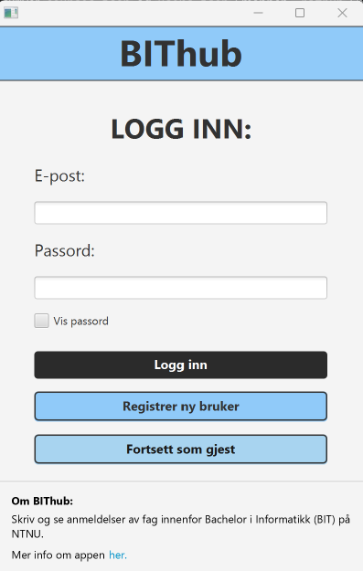</a>
    </td>
    <td align="center">
      <b>Registrer ny bruker</b><br>
      <a href="bilder_release3/RegisterUser.png">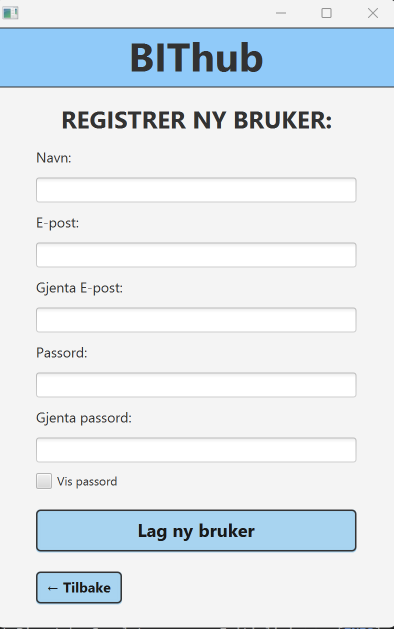</a>
    </td>
    <td align="center">
      <b>Hjemmeside for innlogget bruker</b><br>
      <a href="bilder_release3/Home.png">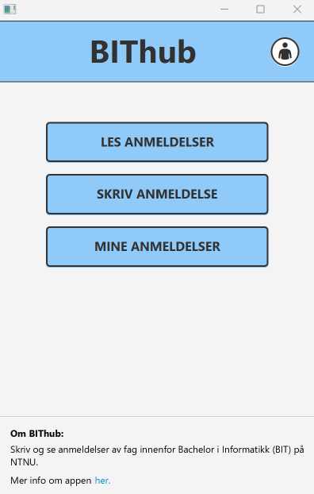</a>
    </td>
    <td align="center">
      <b>Hjemmeside for gjest</b><br>
      <a href="bilder_release3/HomeGuest.png">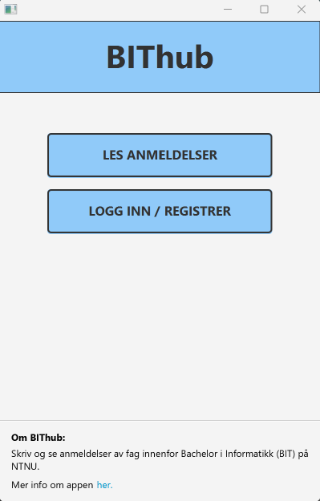</a>
    </td>
  </tr>
</table>

### Emner og anmeldelser

<table>
  <tr>
    <td align="center">
      <b>Søk etter emne</b><br>
      <a href="bilder_release3/CourseSelection.png">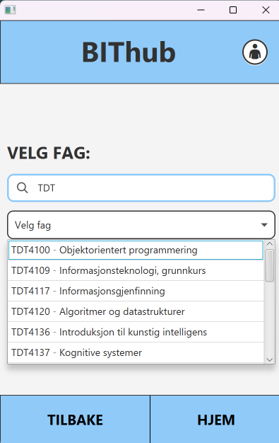</a>
    </td>
    <td align="center">
      <b>Lese anmeldelser</b><br>
      <a href="bilder_release3/ReadReviews.png">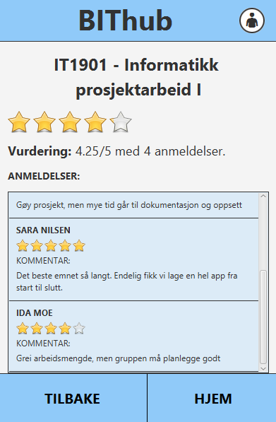</a>
    </td>
    <td align="center">
      <b>Skrive anmeldelse</b><br>
      <a href="bilder_release3/WriteReview.png">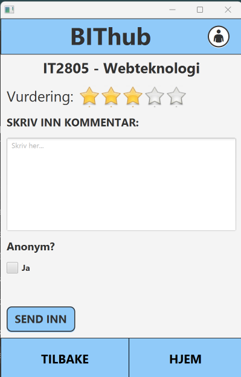</a>
    </td>
  </tr>
</table>

### Egne anmeldelser

<table>
  <tr>
    <td align="center">
      <b>Mine anmeldelser</b><br>
      <a href="bilder_release3/MyReviews.png">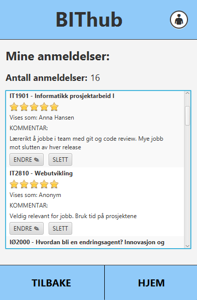</a>
    </td>
    <td align="center">
      <b>Endre anmeldelse</b><br>
      <a href="bilder_release3/EditReview.png">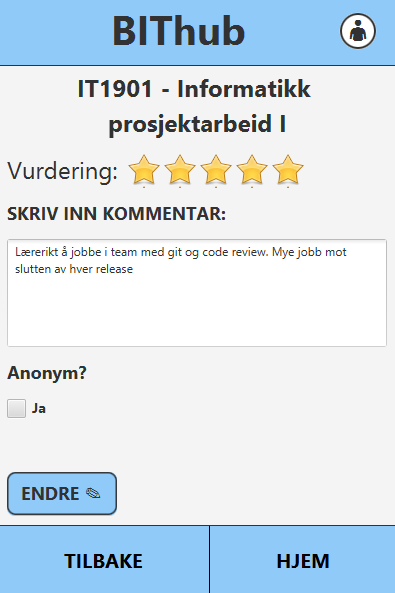</a>
    </td>
  </tr>
</table>

### Profil og informasjon

<table>
  <tr>
    <td align="center">
      <b>Profil</b><br>
      <a href="bilder_release3/Profile.png">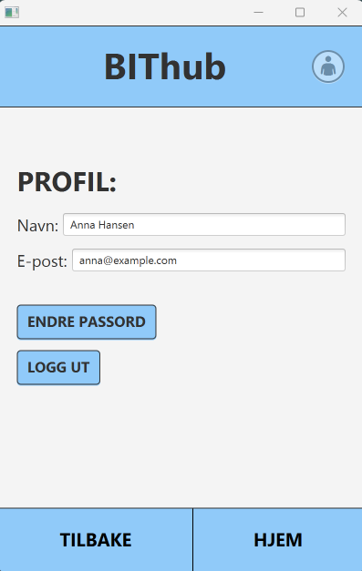</a>
    </td>
    <td align="center">
      <b>Bytte passord</b><br>
      <a href="bilder_release3/ChangePassword.png">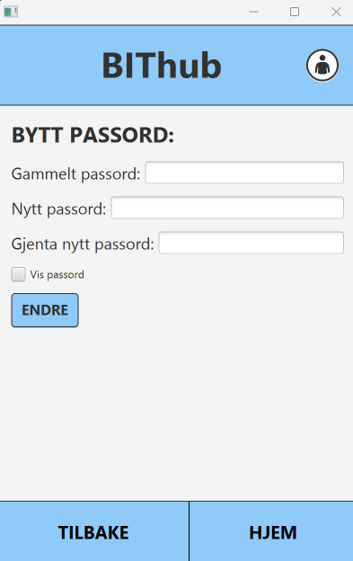</a>
    </td>
    <td align="center">
      <b>Info om appen</b><br>
      <a href="bilder_release3/About.png">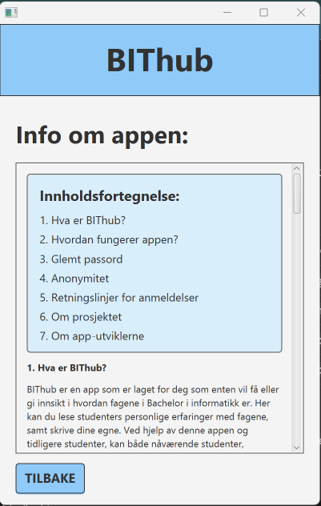</a>
    </td>
  </tr>
</table>

## Arkitektur

Appen består nå av fire moduler: `core`, `file`, `ui` og `springboot/restserver`. JavaFX-klienten sender
forespørsler til serveren over HTTP, og serveren bruker tjenestene i `core` og lagringen i `file`. Modulene,
diagrammene og hvordan klienten og serveren henger sammen, er beskrevet i [README](../../README.md#arkitektur).

Dette er endret i arkitekturen siden release 2:

- **Ny REST-server:** Modulen [`springboot/restserver`](../../bithub/springboot/restserver) tilbyr REST-API-et med
  Spring Boot (#143, #151, #165). Forespørslene er beskrevet i [rest-api.md](rest-api.md).
- **`ui` er ikke lenger avhengig av `file`:**
  [`RemoteReviewRepository`](../../bithub/ui/src/main/java/ui/client/RemoteReviewRepository.java) implementerer
  `ReviewRepository` med HTTP-kall (#172). Klienten bruker derfor `ReviewService` fra `core` som før, og bare
  serveren leser og skriver filene (#175).
- **Pakker etter ansvar og engelske navn:** Klassene er delt inn i pakker etter hva de gjør (#204), og alle
  klasser og filer i `ui` har engelske navn (#223). Inndelingen er beskrevet i [pakkestruktur.md](pakkestruktur.md).

## Valg for release 3

- **Spring Boot uten egne sikkerhetsbiblioteker:** Vi bruker en enkel tokenløsning. Serveren lager et tilfeldig
  token ved innlogging og bestemmer alltid hvem brukeren er ut fra tokenet, aldri ut fra en e-post i forespørselen
  (#176). Tokenene ligger bare i minnet, så alle må logge inn på nytt når serveren starter på nytt.
- **Samme domenelogikk på begge sider:** `ReviewService` validerer anmeldelsen i klienten, slik at brukeren får
  feilmeldingen med en gang. Serveren validerer den på nytt, fordi hvem som helst kan sende forespørsler direkte.
- **REST-kall i bakgrunnen:** Alle kall til serveren går gjennom
  [`BackgroundTaskRunner`](../../bithub/ui/src/main/java/ui/util/BackgroundTaskRunner.java), slik at appen ikke
  fryser mens den venter på svar (#173). Mønsteret er beskrevet i [javafx.md](javafx.md).
- **Søk uten nye REST-kall:** Emnelisten hentes en gang, og søket filtrerer den lokalt (#182).
- **Fortsatt JSON-filer:** Vi lagrer fortsatt i JSON, men bare serveren leser og skriver filene. Lagringen er
  beskyttet mot samtidige forespørsler (#149) og er beskrevet i [persistence.md](persistence.md).

## Anonyme anmeldelser og gjesteanmeldelser

En anonym anmeldelse og en gjesteanmeldelse vises begge uten navn, men de er ikke det samme. En anonym anmeldelse
har en eier. En gjesteanmeldelse har ingen eier.

| Type | Hvem skrev den | Vises som | Eier lagret | Kan endres og slettes av |
| --- | --- | --- | --- | --- |
| `USER` | En innlogget bruker | Navnet til brukeren | Ja | Eieren |
| `ANONYMOUS` | En innlogget bruker som har valgt å være anonym | «Anonym» | Ja, men e-posten sendes aldri ut fra serveren | Eieren |
| `GUEST` | En gjest i release 2, før innlogging ble påkrevd | «Gjest» | Nei, `ownerEmail` er `null` | Ingen |

Typen avgjøres av [`AuthorType`](../../bithub/core/src/main/java/core/model/AuthorType.java). Fra #183 krever nye
anmeldelser innlogging, så det blir ikke laget nye gjesteanmeldelser. De som finnes, er gamle anmeldelser fra
release 2.

## Tester og testdekning

Alle de fire modulene har tester. Vi tester hvert lag for seg, og har i tillegg tester som starter hele serveren og
sender ekte HTTP-forespørsler. REST-klienten i `ui` testes både mot en falsk server og mot den ekte serveren.
Ingen av testene trenger at serveren startes på forhånd. Testene er beskrevet i [code-quality.md](code-quality.md)
og [rest-tester.md](rest-tester.md).

| Modul | Instruksjonsdekning | Grendekning |
| --- | --- | --- |
| core | __ % | __ % |
| file | __ % | __ % |
| ui | __ % | __ % |
| springboot/restserver | __ % | __ % |

Ved innlevering av release 3 gir `mvn clean verify` ingen Checkstyle-warnings og ingen SpotBugs-funn utover de
dokumenterte unntakene i [code-quality.md](code-quality.md).

### Manuell testing av pakkingen

Windows-pakkingen er manuelt verifisert på Windows 10 med
WiX Toolset 3.14.1.

Følgende er verifisert på Windows:

- `mvn clean verify`: 648 tester bestått (core 173, file 72, ui 273, restserver 130), ingen Checkstyle-brudd eller SpotBugs-funn.
- `mvn -pl ui javafx:jlink` oppretter `ui/target/bithub/` og `bithub.zip`.
- Jlink-klienten starter med `bin\bithub.bat` og fungerer mot server-JAR-en:
  innlogging, gjestemodus og lesing og skriving av anmeldelser.
- Generering av Windows-installasjonsfil med jpackage via Maven.
- Generering av Windows app-image med pakkeskriptet.
- Oppstart av Spring Boot fra kjørbar JAR.
- HTTP 200 og JSON-respons fra REST-endepunktet `/api/courses`.
- Korrekt serveradresse i den installerte klientens `BIThub.cfg`.

Den tidligere Windows-løsningen er også prøvekjørt med installert
JavaFX-klient mot kjørende REST-server.

macOS-pakkingen er også manuelt testet. Linux-pakkingen er konfigurert
via Maven, men er foreløpig ikke manuelt verifisert.

## Arbeidsflyt og samarbeid

Vi har fortsatt med samme arbeidsflyt som i release 2. Den er beskrevet i [workflow.md](workflow.md). Alt arbeid
starter i et issue og gjøres i egen branch. Før en pull request henter vi inn siste versjon av `master` og kjører
`mvn clean verify`, og minst to andre på gruppen ser over endringene før de blir merget.

I release 2 sto `Co-authored-by` over issue-referansen i commit-meldingene, så GitHub viste ikke medforfatterne. I
release 3 står linjen helt nederst, og parprogrammeringen vises på GitHub.

Hvordan vi planla og fordelte arbeidet, står i [teamwork.md](teamwork.md), og hva hvert medlem har bidratt med, står
i [contribution.md](contribution.md). De to største utfordringene vi hadde, er beskrevet i
[challenges.md](challenges.md).

## Eksempeldata

Mappen [eksempeldata](eksempeldata/) inneholder anmeldelser av alle emnene i emnelisten, skrevet av seks
testbrukere. Med dem har alle emnene anmeldelser, gjennomsnitt og stjerner, både for gjester og for innloggede
brukere.

- [courses.json](eksempeldata/courses.json): 108 anmeldelser, 2–4 per emne, både med navn og anonyme. Alle
  anmeldelsene har en eier.
- [users.json](eksempeldata/users.json): seks testbrukere med passordhash og salt.

Dataene er laget ved å bruke appen. Ingen bruker har mer enn én anmeldelse per emne (#251).
Eksempeldataene fra release 2 ligger fortsatt i [docs/release2/eksempeldata/](../release2/eksempeldata/).

### Testbrukere

Alle testbrukerne har passordet `Bithub214!`.

| Navn | E-post | Anmeldelser |
| --- | --- | --- |
| Anna Hansen | anna@example.com | 16 |
| Emil Berg | emil@example.com | 17 |
| Sara Nilsen | sara@example.com | 18 |
| Jonas Lie | jonas@example.com | 19 |
| Ida Moe | ida@example.com | 19 |
| Magnus Strand | magnus@example.com | 19 |

Dette er fiktive brukere med offentlige testpassord. Passordene lagres som hash
med PBKDF2-HMAC-SHA256, 600 000 iterasjoner, 16 byte salt og 32 byte hash, begge
Base64-kodet.

### Bruke eksempeldataene

Serveren leser og skriver `courses.json` og `users.json` i mappen `.bithub` i
hjemmemappen din. Kopier begge filene dit før du starter serveren.

**Har du allerede filer i `.bithub`, blir de overskrevet.** Ta en kopi først hvis du vil beholde dem.

Fra rotmappen i repoet, på macOS, Linux og i Eclipse Che:

```bash
cp -r ~/.bithub ~/.bithub-backup   # bare hvis du har egne data
mkdir -p ~/.bithub
cp docs/release3/eksempeldata/courses.json docs/release3/eksempeldata/users.json ~/.bithub/
```

På Windows (PowerShell), fra rotmappen i repoet:

```powershell
Copy-Item "$HOME\.bithub" "$HOME\.bithub-backup" -Recurse   # bare hvis du har egne data
New-Item -ItemType Directory -Force "$HOME\.bithub"
Copy-Item docs\release3\eksempeldata\courses.json, docs\release3\eksempeldata\users.json "$HOME\.bithub\" -Force
```

`$HOME` skal stå akkurat slik. PowerShell bytter det ut med hjemmemappen din.

Start så serveren og appen som beskrevet i [README](../../README.md#kjøre-lokalt).

For å starte på nytt med eksempeldataene: stopp serveren, kopier begge filene på nytt og start serveren igjen.
For å få tilbake dine egne data: stopp serveren, slett `.bithub` og gi `.bithub-backup` navnet `.bithub` igjen.

### Prøv eksempeldataene

1. Trykk «Fortsett som gjest» og åpne «Les anmeldelser». Alle emnene har anmeldelser. IT1901 har fire, med et
   snitt på 4.25.
2. Logg inn som `anna@example.com` med passordet `Bithub214!`.
3. Åpne «Mine anmeldelser». Anna har 16 anmeldelser, både med navn og anonyme.
4. Prøv å skrive en ny anmeldelse av IT1901. Appen sier at du allerede har anmeldt emnet, og at du kan endre
   anmeldelsen under «Mine anmeldelser».
5. Logg ut og inn som `emil@example.com` med samme passord. Emil har 17 anmeldelser.
6. Registrer en ny bruker. Den nye brukeren ser alle anmeldelsene, men har ingen under «Mine anmeldelser».