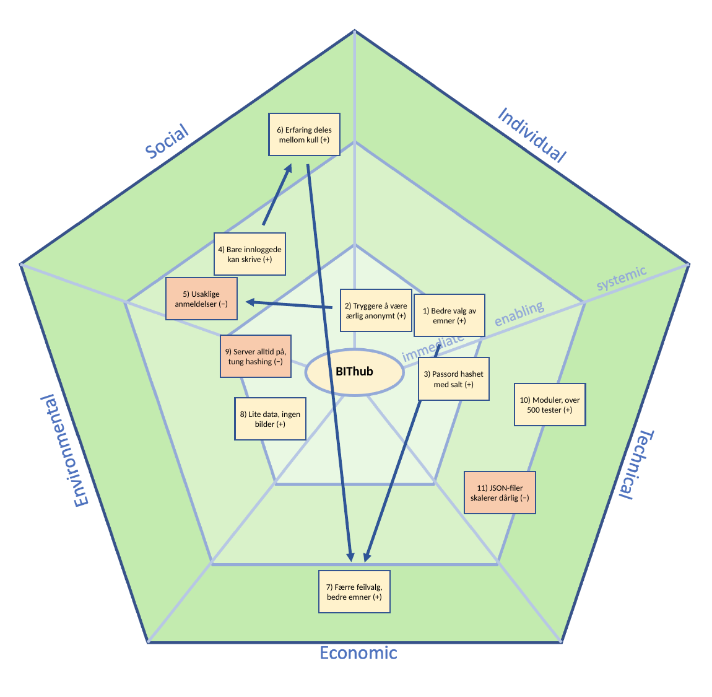

# Bærekraft i BIThub

Dette dokumentet er en refleksjon over bærekraften i BIThub. Vi har brukt Sustainability Awareness Framework (SusAF), som ser på fem dimensjoner: individuell, sosial, miljømessig, økonomisk og teknisk. Hver virkning plasseres på ett av tre nivåer. Umiddelbare virkninger kommer direkte av løsningen, muliggjørende virkninger kommer av at den brukes over tid, og strukturelle virkninger endrer samfunnet rundt. Vi har tatt utgangspunkt i at BIThub brukes av NTNU-studenter og kjører på én server.

## SusAD-diagram

Diagrammet er laget i SusAD-malen fra faget. Filen [susad.pptx](bilder_release3/susad.pptx) er laget i PowerPoint. Gule lapper er positive virkninger, og røde er negative. En pil betyr at én virkning påvirker en annen.

| ID | Virkning | Dimensjon | Nivå | Påvirker | Påvirkes av |
|---|---|---|---|---|---|
| 1 | Bedre grunnlag for å velge emner (+) | Individuell | Umiddelbar | 7 | |
| 2 | Tryggere å være ærlig anonymt (+) | Individuell | Umiddelbar | 5 | |
| 3 | Passord lagres som hash med salt (+) | Teknisk | Umiddelbar | | |
| 4 | Bare innloggede kan skrive (+) | Sosial | Muliggjørende | 6 | |
| 5 | Usaklige eller sårende anmeldelser (−) | Sosial | Muliggjørende | | 2 |
| 6 | Erfaringer deles mellom kull (+) | Sosial | Strukturell | 7 | 4 |
| 7 | Færre feilvalg og bedre emner (+) | Økonomisk | Strukturell | | 1, 6 |
| 8 | Lite data og ingen bilder (+) | Miljø | Umiddelbar | | |
| 9 | Serveren er alltid på, og hashingen er tung (−) | Miljø | Umiddelbar | | |
| 10 | Moduler, tester og kodesjekk (+) | Teknisk | Muliggjørende | | |
| 11 | JSON-filer skalerer dårlig (−) | Teknisk | Muliggjørende | | |

## Individuell og sosial bærekraft

BIThub gir studentene et bedre grunnlag for å velge emner (1). Når erfaringer deles fra kull til kull (6), kan det over tid gi færre feilvalg og nyttige tilbakemeldinger til faglærerne (7).

Anonyme anmeldelser gjør det tryggere å si hva man mener (2). Samtidig kan anonymitet gi usaklige eller sårende kommentarer, og vi har ingen moderering (5). Derfor må man være logget inn for å skrive (4). Eieren lagres også når anmeldelsen er anonym, selv om navnet ikke vises.

Vi lagrer bare navn, e-post og anmeldelser, og passordene lagres som hash med salt (3). Brukerne kan slette egne anmeldelser, men ikke kontoen sin.

## Miljø

BIThub bruker lite ressurser. Appen lagrer bare tekst i små JSON-filer og har ingen bilder eller video (8). Det som bruker mest strøm, er at REST-serveren må være på hele tiden, og at passordhashingen bruker 600 000 iterasjoner (9). Det siste er et bevisst valg for sikkerheten, og det skjer bare ved innlogging, registrering og bytte av passord. Appen kjører på maskiner studentene allerede har.

## Økonomisk bærekraft

BIThub er bygget med gratis verktøy og biblioteker med åpen kildekode. Den største gevinsten er indirekte: færre feilvalg betyr mindre tid og studiefinansiering brukt på emner som ikke passer (7).

## Teknisk bærekraft og vedlikeholdbar kode

Koden er delt i modulene `core`, `file`, `ui` og `springboot/restserver`, og pakkene er delt etter ansvar, som beskrevet i [pakkestruktur.md](pakkestruktur.md). Vi har over 500 tester, og Checkstyle og SpotBugs sjekker koden, som beskrevet i [code-quality.md](code-quality.md) (10). Det gjør koden lettere å forstå og endre for nye utviklere.

Svakheten er lagringen. JSON-filer fungerer for noen få brukere, men ikke for hele NTNU (11). Begrensningene er beskrevet i [persistence.md](persistence.md). Lagringen ligger bak grensesnittene `ReviewRepository` og `UserRepository`, så den kan byttes ut med en database uten å endre resten av appen.

## Hva kan forbedres

- Mulighet for å rapportere eller moderere anmeldelser.
- Mulighet for å slette egen konto.
- Innloggingen bør gå ut etter en tid, i stedet for å vare til man logger ut eller serveren startes på nytt.
- En database i stedet for JSON-filer.
- Testing av universell utforming, for eksempel med skjermleser.
